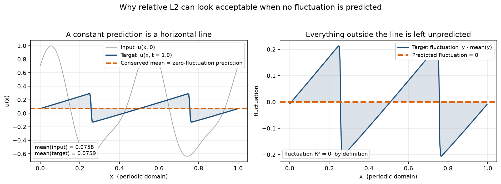

# 相对 L2 是一个「和」

## 一个看起来还行的模型，其实没预测波动

我训完一个 MLP DeepONet，测试相对 L2 是 **0.39357**。同一数据、同一划分、同一预算下，只输出守恒均值的基线是 **0.37577**，FNO 是 **0.22835**。

正常读法：DeepONet 比基线差一点，FNO 好很多。我一开始也这么读。

直到把误差拆开：MLP 的**波动份额是 0.2209**，而"根本不预测波动"的参照值是 **0.2200**。逐样本波动 R² 是 **−0.0042 ± 0.0072**。

那个 0.39357 的模型，在波动上和什么都不做无法区分。它看起来还行，只是因为把一条水平线画在了正确的高度上。

---

## 水平线为什么能拿到不错的分数

周期 Burgers 的空间均值守恒——目标的平均值和输入的平均值是同一个数，实测相关 **1.000000**。解里有一个分量**不用解方程、读输入就能拿到**。

而相对 L2 把整个场一起算：守恒均值既在分子也在分母，而且它是容易的那一半。所以相对 L2 是一个**和**：容易的守恒分量 + 真正要学的波动分量。一个和，看不出变化发生在哪一半。

*PDEBench 1D Burgers Nu=0.001 的一条真实轨迹。左：输入场、目标场与守恒均值；右：目标波动与"预测波动 = 0"。图中为单条轨迹示意，正文数字是测试集统计值。*

---

## 我做了什么

一行毕达哥拉斯定理，把误差平方精确拆成均值份额与波动份额，两者相加恰好等于相对 L2 的平方。这不是新定理，只是**账目**——让"误差在哪一半"可算。

有了账目还得有零点。我定义**零波动参考**：只给常数场、不给任何起伏的预测器，代入 R² 恰好得 0 分。妙的是，把均值取准的那个（相对 L2 0.37577）和全零预测都落在 0 分——这说明波动 R² **对均值完全不敏感，只测波动，不是总精度**。

再给一个**天花板**：DeepONet 的输出只能落在 trunk 基张成的空间里，因此哪怕 branch 是完美 oracle，技能也有一个只依赖这组基的上界，而且这个上界真的能被取到、**不需训练**就能算。实际技能与天花板之差，就是本可以达到却没达到的部分。

---

## 两件让我改观的事

**不是没调好，也不是划分偶然。** 训练量放大 33 倍，总相对 L2 基本持平（0.39357 → 0.42075），逐样本波动技能却从 −0.0042 掉到 −0.4157；175 个干预配置无一为正。后来我从第一个划分 1400 条轨迹的**补集**另抽一个划分、阈值重拟合、重训 315 个 run，差距仍从 +0.6545 变成 **+0.6165**。

**指标自己也会骗人。** 20000 步时，能量加权波动 R² 是 **+0.2126**，逐样本是 **−0.2470**——同一份权重，一个说改善一个说恶化。前者被少数高能量样本主导，那次"改善"只集中在它们身上，典型样本其实变差了。如果我只报其中一个，结论会反过来。这一条和 Burgers 无关：**选错指标会把失败读成成功。**

天花板的用处也在显出来：Fourier trunk 在 t=2.00 的上界是 **+0.9845**、实际 **−0.3774**，trunk 几乎能完美表示波动，模型就是不产生它；同一个 trunk 在线性对流上差距只有 0.058。所以约束在输入到系数的映射，不在基函数。

---

## 一个诚实的转折

**这项工作没有让任何模型变好。** 没有新架构、新训练法、修复手段，也没有"为什么学不会波动"的因果解释。两个公式都是标准线性代数。我甚至不能说波动 R² 比相对 L2 更准——它对均值不敏感，一个均值稀烂、整体不能用的模型照样能拿高分。两者盲区不重叠，所以主张**一起报**；它自己还有适用范围。

它的定位是**评估方法 + 诊断实证**：指出度量盲区，给个补上它的量，再交一份带边界、可复现的负面证据。

意义大概三层：看到"相对 L2 = 0.39"时多问一句"它到底学到了什么"；三条零成本报告建议（报均值份额、两个波动 R² 都报并说明主指标、声明预测时长）；以及怎么让一个负结果站得住——预注册协议、代码字节锁定、每个数字被测试钉死、无共同轨迹的独立划分复现，还有论文里专门记下的**两项主动撤回的主张**。

我没答的：gap 混合了容量、优化和数据量，分不开；没有外部真值；没有下游验证；那条先验阈值规则虽预注册对了 52/55，但在可压缩 CFD 上明确失败，它是经验规律、不是定理。

---

如果只记一句：**相对 L2 是一个和，它把"守恒律白送的"和"模型真正学到的"加在一起，所以无论这个和变大、变小还是不变，都看不出变化发生在哪一半。**

下次读到一个漂亮的相对误差，不妨先问：那条水平线，是不是画在了正确的高度上？

**代码与全部实验记录**：[GitHub](https://github.com/xchenio/operator-error-decomposition) · [Zenodo DOI 10.5281/zenodo.23765688](https://doi.org/10.5281/zenodo.23765688)

*本文是对一项公开研究的中文解读，不是投稿版本译文；数字与结论以英文原稿为准。*
