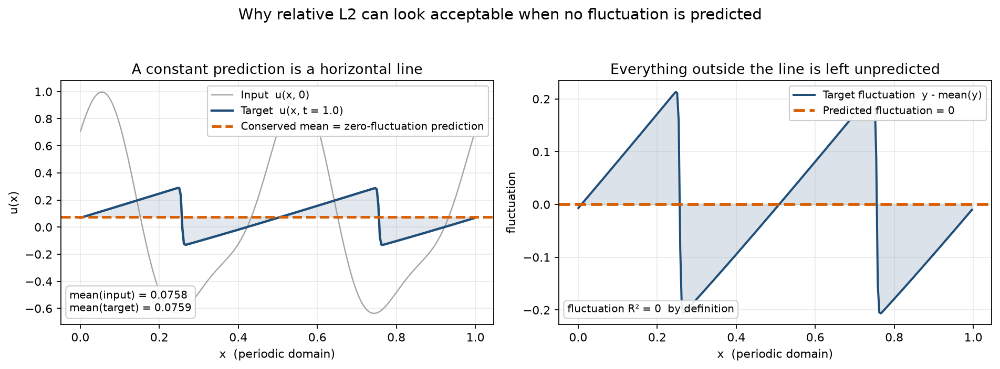

# 相对 L2 是一个「和」：一个可算的均值/波动诊断

## 技术向版本

> 这一版保留完整数学表述与 §5.7 的上界表，面向想核查推导的同行。行内公式用 `$...$`、块公式用 `$$...$$`，需要 MathJax / KaTeX 渲染。
> 若平台只渲染块公式、不渲染行内公式，改用 `relative-l2-is-a-sum-technical-plaintext.md`（行内符号为纯文本，内容一致）。
> 数字与结论以英文原稿 `paper/main.md` 为准；本文不是投稿版本译文。

---

## 1. 问题：守恒分量进了分母

周期 Burgers 满足

$$\frac{d}{dt}\int u\,dx = -\Big[\frac{u^2}{2}\Big] + \nu[u_x] = 0,$$

所以目标场的空间均值等于输入场的空间均值。在三个划分上实测 `corr(mean(x), mean(y)) = 1.000000`，平均绝对差约 $3\times10^{-5}$（§3.4）。

常用的相对 L2 把整个场一起算：

$$\mathrm{relL2}_j^2 = \frac{\|p_j - y_j\|^2}{\|y_j\|^2}.$$

守恒均值既在分子也在分母，且是容易的那一半。于是它是一个**和**，看不出误差落在哪一半。后果是：只输出精确输入均值 + 零波动的预测器，测试相对 L2 就有 **0.37577**——这不是弱基线，而是**最优的守恒律预测器**（§3.4）。



*PDEBench 1D Burgers Nu=0.001 的一条真实轨迹（脚本 `scripts/make_blog_figure.py`）。图中 `mean(input)=0.075847`、`mean(target)=0.075859`，差 1.24e-05。图中为单条轨迹示意，正文数字是测试集统计值。*

---

## 2. 命题 1：精确正交分解

写 $\bar y_j = N^{-1}\mathbf{1}^{\top}y_j$、$y_{c,j}=y_j-\bar y_j\mathbf{1}$，对 $p$ 同理。因为 $\mathbf{1}^{\top}(p_{c,j}-y_{c,j})=0$，两项正交，由毕达哥拉斯定理（§3.1）：

$$\|p_j-y_j\|^2 = N(\bar p_j-\bar y_j)^2 + \|p_{c,j}-y_{c,j}\|^2 .$$

除以 $\|y_j\|^2$ 并对样本取平均，得两个**精确可加**的份额：

$$\underbrace{\mathbb{E}_j\frac{N(\bar p_j-\bar y_j)^2}{\|y_j\|^2}}_{\text{mean share}} + \underbrace{\mathbb{E}_j\frac{\|p_{c,j}-y_{c,j}\|^2}{\|y_j\|^2}}_{\text{fluctuation share}} = \mathbb{E}_j\,\mathrm{relL2}_j^2 .$$

`scripts/diagnose_fluctuation.py` 从存档 checkpoint 复算两个份额，并输出 closure 项；测试套件断言 closure 到机器精度为 0（§5.2 表中 0.22002 对应 oracle 行的 `squared_error_closure = 0.0`）。

> **性质**：这是对任意预测成立的**恒等式**，不是因果归因，也不产生新信息。它的价值是让两半可分别计算、且相加闭合。

---

## 3. 两个技能度量与零波动参照

记逐样本波动能量 $e = \mathbb{E}_j\|y_{c,j}\|^2/\|y_j\|^2$。§3.2 定义：

| 度量 | 定义 | 主导者 |
|---|---|---|
| `fluctuation_r2` | $1 - \sum_j\|p_{c,j}-y_{c,j}\|^2 / \sum_j\|y_{c,j}\|^2$ | 高能量样本 |
| `fluctuation_r2_per_sample`（**主指标**） | $1 - (\text{fluctuation share})/e$ | 每个样本等权 |

**零波动参考**：令 $p_{c,j}=0$，则波动份额 $=e$，于是 $R^2 = 1-e/e = 0$。因此**任何波动为零的预测都得 0 分**——包括精确均值预测（相对 L2 0.37577）和全零预测。这正说明 $R^2$ 对均值不敏感，*never a measure of total accuracy*。

两者必须并列报告：§5.4 在 20000 步时能量加权 **+0.2126**、逐样本 **−0.2470**，符号相反。

---

## 4. 命题 2：trunk 张成空间上的紧上界

设 trunk 特征矩阵 $\Phi\in\mathbb{R}^{N\times p}$，$S=\mathrm{span}([\Phi,\mathbf{1}])$，$P$ 是到 $S$ 的正交投影。任何 DeepONet 输出 $p_j\in S$，且 $\mathbf{1}\in S$ 使 $p_{c,j}\in S$。分解

$$p_{c,j}-y_{c,j} = \underbrace{(p_{c,j}-Py_{c,j})}_{\in S} - \underbrace{(I-P)y_{c,j}}_{\in S^\perp}$$

两项正交，故 $\|p_{c,j}-y_{c,j}\|^2 \ge \|(I-P)y_{c,j}\|^2$，得（§3.3）

$$R^2_{\text{per sample}} \le 1-\frac{s_{\min}}{e}, \qquad s_{\min}= \mathbb{E}_j\frac{\|(I-P)y_{c,j}\|^2}{\|y_j\|^2}.$$

取 $p_j = Py_{c,j}+c\mathbf{1}$ 即达等号，故**对给定 trunk 是紧的**，不改 $\Phi$ 无法提高；且计算它**只需 trunk，不需训练 branch**。

> 适用范围：只对 $p_j\in S$ 的 DeepONet 类输出成立，**FNO 不适用**。它是关于可达集合的陈述，不是对某次拟合误差的归因。

比较上界与实际技能可分离两种失败模式：达近上界 → trunk span 是约束；远低于上界 → branch（输入到系数的映射）是约束。**gap 就是 branch 损失掉的份额**。

---

## 5. 为什么是常向量这个投影（§3.5）

1. **代数**：$\mathbf{1}$ 与其零均值补空间是 $\mathbb{R}^N$ 里唯一不需要选基、不需训练量、不需超参的正交二分。POD 模态、低/高频截断、按空间或按样本分，都需先选基或截断点，份额便不再对任意预测精确可加、也不再跨架构可比。$\mathbf{1}$ 是一维、补空间 $N-1$ 维，这也是最粗的划分。
2. **物理**：守恒均值可从输入直接读出，均值份额是白送的、波动份额才是要学的。**反例对照**：稳态 Darcy 上 input–output 均值相关 **−0.873**，无守恒律，同一构造的相对 L2 变成 **3.6843**（§5.6.4）。基线地位是算子物理的属性；零波动参照则是纯代数的。
3. **诊断**：只有这一半给得出自然零点；命题 2 也依赖 $\mathbf{1}\in S$。

命题 1 可推广到任意正交投影（其它守恒量、低/高频分裂），代价是失去跨族可比性且零点不再对应"什么都不学"。

---

## 6. 主结果（§5.2，Burgers ν=0.001，t=1.00）

| Method | Test relL2 | R² (energy) | **R² (per sample)** | mean share | fluctuation share |
|---|---:|---:|---:|---:|---:|
| oracle input mean | 0.37577 | 0.0000 | **0.0000** | 0.0000 | 0.2200 |
| MLP DeepONet | 0.39357 | −0.0056 ± 0.0094 | **−0.0042 ± 0.0072** | 0.0180 | 0.2209 |
| Fourier DeepONet | 0.41231 | −0.0124 ± 0.0356 | **−0.0934 ± 0.0886** | 0.0340 | 0.2406 |
| FNO | 0.22835 | +0.6282 ± 0.0187 | **+0.6503 ± 0.0222** | 0.0023 | 0.0769 |

MLP 的波动份额 0.2209 与零波动参考 0.2200 无法区分；FNO 把它降到 0.0769。FNO − MLP 的 gap = **+0.6545**，是最稳定的单一量。

---

## 7. §5.7 上界表（九个设置、45 个训练好的 trunk）

| Setting | Trunk | basis rank | **bound** | achieved | **branch gap** |
|---|---|---:|---:|---:|---:|
| Advection t = 1.00 | Fourier | 62.8 | +1.0000 ± 0.0000 | +0.9424 | **0.058** |
| Advection t = 2.00 | Fourier | 62.2 | +0.9999 ± 0.0000 | +0.9354 | **0.065** |
| Burgers t = 0.25 | Fourier | 42.6 | +0.9590 ± 0.0044 | +0.4248 | 0.534 |
| Burgers t = 1.00 | Fourier | 39.4 | +0.9737 ± 0.0062 | −0.0934 | 1.067 |
| Burgers t = 2.00 | Fourier | 39.6 | +0.9845 ± 0.0045 | −0.3774 | 1.362 |
| Advection t = 1.00 | MLP | 7.4 | +0.5785 ± 0.0458 | +0.1817 | 0.397 |
| Burgers t = 0.25 | MLP | 6.8 | +0.5855 ± 0.0459 | +0.1695 | 0.416 |
| Burgers t = 1.00 | MLP | 4.4 | +0.5072 ± 0.0516 | −0.0042 | 0.511 |
| Burgers t = 2.00 | MLP | 4.2 | +0.5180 ± 0.0462 | −0.0918 | 0.610 |

**上界在 45 个 trunk 上从不违反**，说明它在真实 checkpoint 上成立而不只在纸上。三条推论：

1. Fourier trunk 的张成空间在任何 PDE、任何视界都不是约束（上界 0.96–1.00），包括 t=2.00 实际 −0.3774 时。
2. **gap 才跟踪难度**：同一个 Fourier trunk 在平移问题只丢 0.058（translation 是相位移动，线性读出可表达），Burgers 上从 0.534 涨到 1.362。
3. MLP trunk 的有效秩塌到 4–7，上界降到 0.51–0.59，但实际技能仍远低于这个已降低的上界——**两个 trunk 主要都败在 branch**。

这也是技能临界时长的解释：可达集合不随预测时长收缩，收缩的是映射到它的能力。线性插值给出约 0.98（MLP）、0.86（Fourier）、1.94（FNO）；线性对流上无衰减，说明跟随非线性谱演化而非经过时间。

> ⚠️ 这是**损失位置的定位，不是因果机制**。gap 混合了 branch 容量、优化程度与 1000 条训练轨迹；固定 trunk 只换 branch 的干预实验未做，§6 列为首要待办。

---

## 8. 排除性证据

**预算阶梯**（§5.4，MLP DeepONet）：

| updates | Test relL2 | R² (energy) | **R² (per sample)** |
|---:|---:|---:|---:|
| 1500 | 0.39357 | −0.0056 | −0.0042 |
| 5000 | 0.39729 | +0.0165 | −0.0640 |
| 20000 | 0.39311 | **+0.2126** | **−0.2470** |
| 50000 | 0.42075 | +0.1496 | −0.4157 |

33× 预算下总误差不改善、逐样本技能更差；20000 步那格同时暴露能量加权指标的假阳性。§5.3 另重算 175 个干预 run（trunk 架构、白化、均值提升、零初始化、调度、batch size、训练子集规模），无一为正。

**PI 臂**（§5.11）：PDE loss 从 1e-1 收敛到 6e-5，波动份额 **0.1875 精确等于 oracle**，均值份额从 0.0334 涨到 **0.1246**——缺陷在守恒律那半，不在波动。

**独立划分复现**（§5.17）：split 2 取自 split 1 全部 1400 个 id 的补集（seed 20261028，无共同轨迹），阈值重拟合，315 runs / 21 families。MLP −0.0003 ± 0.0167、FNO +0.6162 ± 0.0347、**gap +0.6165**（split 1 为 +0.6545）；阈值漂移 1.3% / 11.6%，在预声明 25% 带内。FNO 在 split 2 全程为正（t=2.00 时 +0.0972 ± 0.1689），不穿零，故该臂退出复现。

---

## 9. 指标本身的效度（§3.5）

不是"比相对 L2 更准"，而是**可靠、可判别、可预测、有已知范围**：

| 类型 | 证据 |
|---|---|
| 构造 | 两份额闭合到机器精度；零波动参照使精确均值与全零预测都得 0；上界由 oracle 达到、45 trunk 从不违反 |
| 判别 | 不是恒给负分：FNO +0.6503、t=0.10 三者全正（最高 +0.9859）、平移 gap 0.058 对 Burgers 1.362、Darcy 相关 −0.873 的反例 |
| 定位 | PI 臂波动份额精确等于 oracle，与收敛残差一致 |
| 预测 | 先验阈值预注册 52/55；分层 27/30（可区分）、5/6（边界），基线 16/30；CFD 上 3/6 失败 |
| 可靠性与范围 | split 2 gap +0.6545 → +0.6165；§5.12 给出适用范围（CV 约 <1、极差 <100 倍），并排除 Darcy β=0.01（CV 2.43、极差 343 倍） |

**未证之事**：无外部"波动技能真值"可对照，故不能称更接近真值；无形式化最优性/公理化刻画；无下游任务验证。

---

## 10. 报告建议（§5.19）

1. 报**均值份额**，不只报总相对 L2——均值份额近 1 说明模型与守恒律持平、没预测别的东西。
2. 逐样本与能量加权波动 R² **都报**，并声明哪个是主指标；两者在 Burgers ν=0.001 上符号相反。
3. **声明预测时长并在该时长重测**：Fourier trunk 在 t=0.25 领先 MLP +0.2553，t=1.00 落后 −0.0892。离开时长谈基函数质量不成立。

两条附带警告：优化总相对 L2 可让逐样本波动技能**变差**（§5.10）；逐样本 R² 落在两个种子标准差内时，两个方向都不算证据，应报区间而非点估计的符号。

---

## 11. 复现入口

```powershell
python -m unittest discover -s tests          # 144 tests，不需 50 GB 数据
python scripts/verify_manuscript.py
python scripts/analyze_prediction_ledger.py
python scripts/make_blog_figure.py            # 重画本文配图
```

| 想查 | 位置 |
|---|---|
| 原始 run | `results/<family>/<arch>_s*/result.json`（含 `source_sha256`、`git_commit`、`selection = "last fixed-budget checkpoint"`） |
| 分解复算 | `results/fluctuation_*/`、`results/fluctuation_v1/reference.json` |
| 上界 | `results/skill_bound_v1/report.json` |
| 阈值台账 | `results/skill_prediction_v1/report.json` |
| split 2 | `results/rs2_*`、`docs/REPLICATION_SPLIT2_V1.md` |
| 代码归档 | https://doi.org/10.5281/zenodo.23765688 |

稿件里的分解类数字**不是训练日志直接读出的**，而是 `diagnose_fluctuation.py` 从 `checkpoints/latest.pt` 重算、再由 `tests/test_paper_evidence.py` 断言与 `main.md` 一致。

---

*本文是对一项公开研究的中文技术解读，不是投稿版本译文。*
