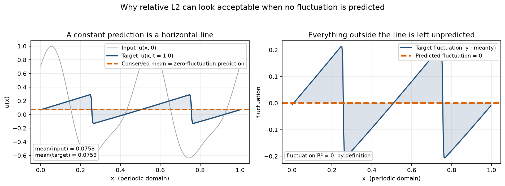

# 相对 L2 是一个「和」

## 一个看起来还行的神经算子，其实没预测波动

有一次我在 1D Burgers 方程上训完一个 MLP DeepONet，测试相对 L2 是 **0.39357**。同一个数据、同一个划分、同一个训练预算下，只输出守恒均值的基线是 **0.37577**，而 FNO 是 **0.22835**。

看着这份结果，你大概会说：DeepONet 比基线差一点，FNO 好很多，就这样。我一开始也是这么读的。

后来我把误差拆开，发现 MLP DeepONet 的**波动份额是 0.2209**，而"根本不预测波动"的参照值是 **0.2200**。换成逐样本波动 R²，它是 **−0.0042 ± 0.0072**。

也就是说：那个 0.39357 的模型，在波动上和"根本不预测波动"**无法区分**。它看起来还行，只是因为把一条水平线画在了正确的高度上。

这篇小文想讲清楚的是：这不是那个模型的毛病，是**我们量它的方式**有结构性盲区。

---

## 一条水平线为什么能拿到不错的分数

周期 Burgers 方程满足空间均值守恒——目标场的平均值，和输入场的平均值是同一个数。我在三个数据划分上都量了，相关系数是 **1.000000**，平均绝对差约 **0.00003**。

这意味着解里有一个分量**不用解方程、读输入就能拿到**。

问题来了：相对 L2 是把预测和目标的**整个场**一起算的。守恒均值既在分子里、也在分母里，而且它是容易的那一半。于是相对 L2 是一个**和**：

> 容易的守恒分量 + 真正要学的波动分量

一个和，看不出变化发生在哪一半。模型把容易的那半做对了，总分就不会太难看——哪怕另一半什么都没做。



*PDEBench 1D Burgers Nu=0.001 的一条真实轨迹。左：输入场、目标场与守恒均值；右：目标波动与「预测波动 = 0」。图中为单条轨迹示意，正文数字是测试集统计值。*

更麻烦的是，这不是 Burgers 独有的。任何有守恒量的 PDE 上，只要还用整体相对误差报告结果，这个盲区都在。

---

## 我做的事：给这个和拆账，再给一把尺子定零点

第一步其实只是一行毕达哥拉斯定理。把场写成常向量和零均值残差之和，因为两者正交，误差平方可以精确拆成两块：

```
‖p − y‖²  =  N(p̄ − ȳ)²  +  ‖p_c − y_c‖²
     均值份额              波动份额
```

这两块**精确相加**等于相对 L2 的平方，对任意预测都成立。所以它不是什么新定理，也不产生新信息——它只是**账目**，让"误差在哪一半"变成可算的数。

光有账目还不够，得知道"什么都不学"该得多少分。于是我定义**零波动参考**：一个只给常数场、完全不给空间起伏的预测器。代入 R² 的定义，它恰好得 **0 分**。妙的是，两个总精度天差地别的预测——把均值取准的那个（相对 L2 0.37577）和全零预测——都落在 0 分。这正说明波动 R² **对均值完全不敏感，它只测波动，不是总精度**。

有了零点，"−0.0042" 才有了含义：不比什么都不做更好。

第二步是给一个**天花板**。DeepONet 的输出只能落在它那组 trunk 基函数张成的空间里，所以哪怕 branch 是完美的 oracle，波动技能也有一个只依赖这组基的上界——而且这个上界真的能被 oracle 取到，是**紧的**。关键是它**不需要训练**，给我 trunk 和标签就能算。

于是我手里有了三个数：误差在哪一半、零在哪、天花板在哪。**实际技能与天花板之差，就是"本可以达到、却没达到"的那部分。**

---

## 三件让我改变看法的事

**一、这个现象不是没调好，也不是某个划分的偶然。**

我把训练量放大 33 倍（1500 → 50000 步），总相对 L2 基本持平甚至略差（0.39357 → 0.42075），逐样本波动技能却从 −0.0042 一路掉到 **−0.4157**。另外重算了 175 个干预配置——换 trunk、白化、均值提升、零初始化、学习率调度、batch size、训练子集大小——**没有一组为正**。

后来我又从第一个划分全部 1400 条轨迹的**补集**里另抽了一个划分，两条划分没有任何共同轨迹，阈值在新划分上重新拟合，重训 315 个 run。分离现象照样在：FNO 与 MLP 的差距从 +0.6545 变成 **+0.6165**。

**二、指标自己也会骗人。**

上面那个预算阶梯里，20000 步时出现了一格很刺眼的结果：能量加权的波动 R² 是 **+0.2126**，逐样本的却是 **−0.2470**。同一个模型、同一份权重、同一个指标族，一个说改善、一个说恶化。

原因不神秘：前者被少数高能量样本主导，后者每个样本等权。那次"改善"只集中在高能量样本上，典型样本其实变差了。**如果我只报其中一个，这篇论文的结论会反过来。** 所以后来我两个都报，并明确写了哪个是主指标。

这一条和 Burgers 无关，是我最想让同行带走的东西：**选错指标会把失败读成成功。**

**三、不是"表示不了"，是"没映射到"。**

天花板的用处在这里显出来了。Fourier trunk 在 Burgers 的 t=2.00 上，上界是 **+0.9845**，实际是 **−0.3774**——trunk 几乎能完美表示那个波动，模型就是不产生它。而在平移问题上，同一个 trunk 的差距只有 **0.058**，几乎顶到天花板。45 个训练好的 trunk 上，上界从没被违反过。

所以约束落在输入到 trunk 系数的那张映射上，不在基函数。顺带这解释了一件别的事：预测时间越久技能越差，不是可达集合缩小了，而是映射到它的能力跟不上了；线性对流上没有非线性谱演化，这个衰减就不出现。

还有一个我挺喜欢的交叉验证：物理信息训练（不给目标时刻的监督，只用初值、PDE 残差和周期性）收敛得很好，波动份额 **0.1875 精确等于 oracle**，但均值份额从 0.0334 涨到 **0.1246**。分解直接指出：它不是波动变差了，是守恒律那半没学出来。

---

## 一个诚实的转折

写到这里，可能有人期待我说"于是我修好了 DeepONet"。没有。

**这篇工作没有让任何一个模型变好。** 没有新架构，没有新训练方法，没有修复手段，也没有"DeepONet 为什么学不会波动"的因果解释——固定 trunk 只换 branch 的干预实验我没做。两个公式都是标准线性代数，恒等式那行几步就能推完，我在论文里也明写了不主张新近似理论。

甚至我也不能说波动 R² "比相对 L2 更准"。它对均值完全不敏感：一个把均值预测得一塌糊涂、整体根本不能用的模型，波动 R² 照样可以很高。两者回答的是不同问题，盲区不重叠，所以我主张的是**一起报**，不是替换。它自己还有适用范围——目标范数跨好几个量级时逐样本相除就没意义了，论文里给了一个范围，并主动排除了一个触犯它的设置。

那篇论文的定位其实是**评估方法 + 诊断性实证**：指出一个度量盲区，给一个补上它的量，然后用它交出一份带边界、可复现的负面证据。

---

## 那意义在哪

我想是三层。

**第一层是一个提醒**：在有守恒量的 PDE 上，看到"相对 L2 = 0.39"时，值得多问一句"它到底学到了什么"。守恒分量是白送的，它进了分母，会让一批"效果不错"的结论系统性偏乐观。这不是 Burgers 的事，是报告口径的事。

**第二层是能直接改变别人怎么写结果**：报均值份额，而不只是总相对 L2；两个波动 R² 都报并说明哪个是主指标；声明预测时长并在该时长重测，因为基函数的好坏会随时长反转。这三条不需要重训任何模型，成本几乎为零。

**第三层，也是我花时间最多的：怎么让一个负结果站得住。**

"这个模型没效果"是最容易被一句话打死的结论——没调好、没训够、种子不巧、划分偶然。所以我事先把端点、口径和判定规则写进 23 份预注册协议；把每个 run 绑定到它产生时的代码字节；把稿件里每个数字用测试钉死，改一个就红；把波动份额从存档权重重新算一遍、验证拆解的闭合项到机器精度为零；再在无共同轨迹的第二个划分上整套重跑。

还有一件我觉得该做的事：审计过程中我发现早先有两项主张站不住，就在论文里单独开了一节记录**主动撤回**。判断一篇东西值不值得信，那一节可能比结果表格更有信息量。

---

## 我没答的问题

留几个开口，免得这篇读起来像结论已封：

- 波动技能没有外部"真值"可对照，所以我只能说这个量可靠、能判别、能前瞻预测，不能说它更接近某个真理。
- gap 混合了 branch 容量、优化程度和只有 1000 条训练轨迹的数据量，我分不开它们。
- 没有下游验证：按这个诊断去选模型，后续决策会不会更好，不知道。
- 六个问题族，多数只测了一个参数点；5 个种子共用一个划分，种子标准差反映的只是初始化随机性。
- 我给过一条先验波动能量阈值规则，预注册的 55 个符号预测对了 52 个，但它在可压缩 CFD 上明确失败（3/6）。**它是经验规律，不是定理**，论文里专门标了状态。

---

## 如果只想记住一句

> 相对 L2 是一个**和**。它把"守恒律白送的"和"模型真正学到的"加在一起，所以无论这个和变大、变小还是不变，都看不出变化发生在哪一半。

下次读到一个漂亮的相对误差时，不妨先问一句：那条水平线，是不是画在了正确的高度上？

---

**代码、全部实验记录与预注册协议**：[GitHub](https://github.com/xchenio/operator-error-decomposition) · [Zenodo 归档 DOI 10.5281/zenodo.23765688](https://doi.org/10.5281/zenodo.23765688)

*本文是对一项公开研究的中文解读，不是投稿版本的译文；数字与结论以英文原稿为准。*
