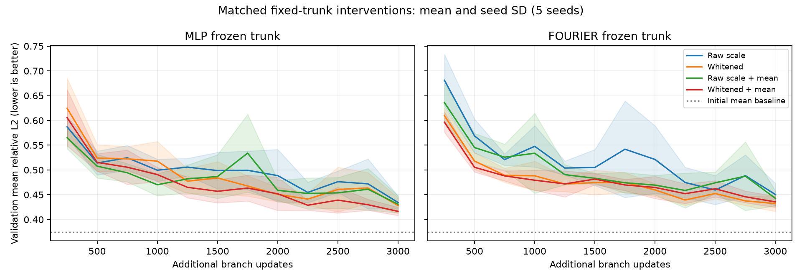

# 固定 trunk：数值条件 × 均值基线消融

## 运行前锁定的协议

- 继承 public_fixed_t1_v1 的数据、训练集归一化、10 个 DeepONet 已训练 trunk。
- 两种 trunk × 五个种子 × 四种处理，共 40 次训练。
- 四种处理：原始尺度 / SVD 白化，各自配合有 / 无初值空间均值输出基线。
- 每个 trunk 特征加常数列，在 float64 中按 rcond=1e-6 截断；原始尺度使用
  U_r S_r V_r^T，白化使用 U_r V_r^T。两者均除以自身元素 RMS，再转 float32。
  二者都有 65 列、相同保留子空间、相同整体特征尺度，仅奇异值分布不同。
  “原始尺度”不是未经截断的旧模型；原始端到端实验仅作外部参考。
- 全部重新初始化同容量 branch：256 输入、3 层 128 宽 tanh、65 输出。
  同一父模型四组具有相同 branch 初始化和批次索引序列。
- 非均值组使用训练目标全局均值作偏移；均值组使用每条输入的空间均值。
  两组共享训练目标全局标准差，均用物理场重建 MSE 训练。并非改用系数 MSE。
- 所有组均允许输入相关的常数输出，比旧模型的全局 bias 更宽松；不能将收益
  全归于正交化。固定 trunk 也不等于端到端模型，且使用额外训练预算。
- Adam lr=1e-3、batch=32、3000 次更新；预先记录 1500 / 3000 两个预算的结果。
  每 250 步验证，每 50 步原子保存断点；测试集不用于选 checkpoint。
- 本次沿用的测试集此前已做探索性分析，因此结果仍是探索性证据。后续最终确认
  必须在未用轨迹上做；本轮不消耗新的最终留出集。

## 执行和恢复

```powershell
& D:\miniconda3\envs\pytorch\python.exe -u -B scripts/run_public_coefficients.py
```

相同命令恢复未完成项，跳过已完成项。校验父 checkpoint、源码、配置、数据和环境。
本轮模型保存在 results/public_coefficients_v1/*/checkpoints/latest.pt（本地，Git 忽略）。
模型、优化器、全部随机状态、步数、历史、基矩阵及预算节点结果一起保存。

## 预先声明的判读

先看验证集配对差值，再完整报告四组测试结果，不挑选有利种子。
若白化在无均值和有均值两组均稳定改善，支持数值条件是可干预因素；并不证明
它是唯一原因。若只增加均值有效，优先考虑输出结构先验。若 1500 到 3000 普遍
改善，说明短预算也有影响。若无效，同样保留否定结果，不追着测试集调参。

## 2026-09-23 汇总：40 / 40 完成

运行配置提交为 `f3d7685`。全部到达 3000 步，1500 步预算节点亦完整。
再次执行原命令，40 项均通过身份检查并跳过，未重复训练。
以下为五个种子的均值 ± 样本标准差，不是跨数据划分的置信区间。

| 固定 trunk | 处理 | 验证误差均值 | 测试相对 L2 |
|---|---|---:|---:|
| MLP | 原始尺度 | 0.43433 | 0.43260 ± 0.00976 |
| MLP | 白化 | 0.42807 | 0.42595 ± 0.01070 |
| MLP | 原始尺度 + 均值 | 0.43088 | 0.42832 ± 0.01756 |
| MLP | 白化 + 均值 | 0.41642 | 0.41594 ± 0.00909 |
| Fourier | 原始尺度 | 0.45047 | 0.43832 ± 0.01925 |
| Fourier | 白化 | 0.43215 | 0.42630 ± 0.01740 |
| Fourier | 原始尺度 + 均值 | 0.44266 | 0.43089 ± 0.01597 |
| Fourier | 白化 + 均值 | 0.43554 | 0.43181 ± 0.01878 |

外部参考：无训练的初值空间均值基线测试误差 0.37577，上一轮 FNO 为
0.22835 ± 0.00680。它们不是本轮相同总训练预算的模型对照。
本轮八组均未超过简单均值基线；不能写成成功提升公开数据性能的结果。

### 配对证据：效果小，不能支撑主要机制叙事

以下是 3000 步验证误差的“处理后减处理前”，负值表示改善：

| 干预 | MLP 平均差 / 改善种子数 | Fourier 平均差 / 改善种子数 |
|---|---:|---:|
| 白化，不加均值 | -0.00626 / 4/5 | -0.01831 / 4/5 |
| 白化，加入均值 | -0.01446 / 4/5 | -0.00712 / 3/5 |
| 均值，不白化 | -0.00345 / 3/5 | -0.00781 / 2/5 |
| 均值，白化 | -0.01165 / 4/5 | +0.00339 / 3/5 |

白化具有小幅平均收益，但个别种子反向；均值干预也不稳定。未做显著性声称。
Fourier 的训练误差也仍高：四组约 0.364–0.392，所以不只是验证泛化差距。
从 1500 到 3000 步，八组平均验证误差均下降（例如 Fourier 白化组
0.47456 -> 0.43215），说明短训练预算确实影响结论，但不能据此推断继续训练
必然达到投影下限。本实验没有比较完整优化器 / 学习率搜索。



### 决策与下一步

暂停将“正交化修复表示问题”作为主要创新路线；现有证据只支持一个有限的
数值条件效应，尚不构成有竞争力的预测方法。

下一轮应先做 branch 可学习性与尺度的诊断，而非直接叠加复杂损失：

1. **小样本拟合检查**：固定基，分别用 32 / 128 个训练样本，判断 branch 能否
   接近这些样本自身的投影误差；区分实现、优化、输入映射容量与泛化问题。
2. **零残差初始化的配对对照**：目前新 branch 随机初始化会扰动均值基线。
   将输出层初始化为零，可使起点精确等于该基线，再与现有初始化匹配比较。
   这只是待验证假设，不保证最终效果改善。
3. 只有前两项通过，才考虑周期卷积 branch 或更长预算，并用验证集决定方向。
   继续保留 FNO 外部参考；不用已看过的测试集筛选超参数。
4. 在未使用轨迹上做最终确认、第二 PDE 验证与物理训练，仍属于未完成工作。

## 记录与验证

- `results/public_coefficients_v1/summary.json`：8 组汇总、两个预算、完整逐种子数值
  和配对差值；汇总前校验配置、数据、源码、环境及配对父模型。
- 每次运行的 manifest/result/progress/events 均保存；40 个可恢复 checkpoint
  留在本地，不写入 Git。
- `tests/test_public_coefficients.py` 在 CPU / CUDA 均通过：同子空间同尺度检查，
  两种处理的强制中断恢复，模型逐张量及最终指标一致，以及配置变更拒绝。
- 全量 unittest discovery 通过 10 个测试。曲线已生成并人工视觉检查。
