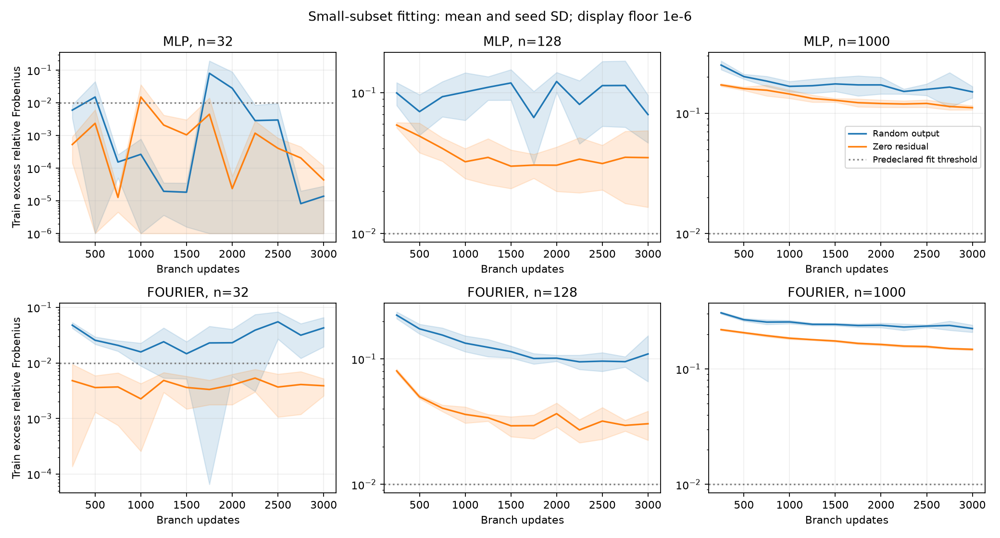

# 小样本拟合与零残差初始化：预先锁定协议

## 2026-09-23

问题一：branch 能否在 32 / 128 个样本上接近固定表示空间的投影误差？
问题二：让初始预测精确等于初值空间均值，能否稳定改善训练与验证表现？

- 2 类父 trunk × 5 个种子 × 32 / 128 / 1000 个训练样本 × 2 种初始化 = 60 次。
- 沿用 public_fixed_t1_v1 的固定 trunk，以及 public_coefficients_v1 的白化基、
  rcond=1e-6、均值偏移、65 输出和 3 层 128 宽 tanh branch。
- 小样本子集来自原训练集的固定排列（seed=20260923），32 嵌套于 128，
  128 嵌套于 1000；全部种子共用该排列。记录原训练数组行号，可经旧协议映射到
  HDF5 轨迹 ID。1000 样本用于判断初始化效果是否只在小样本下出现。
- **这不是少样本泛化实验**：父 trunk 与归一化已经使用过原先 1000 个训练样本。
  本轮只隔离 branch 拟合能力，不能宣传仅用 32 条标签完成训练。
- 每对实验除最后输出层外初始权重完全相同，训练样本顺序相同。
  随机组保留原 Xavier 初始化；零残差组将最后线性层权重和偏置设为零。
  零残差组第 0 步预测必须等于输入空间均值，已纳入测试。
- Adam lr=1e-3，batch=min(32,n)，3000 次更新；固定记录 0 / 1500 / 3000 步。
  每 250 步记录完整训练和验证指标，每 50 步保存所有断点状态。
- 本轮不评价测试集、不选最佳测试 checkpoint、不改变超参数。

## 判据与限制

对每个实际子集，从同一浮点白化矩阵的保留秩空间计算离线投影 oracle，并考虑
逐样本初值均值偏移。报告训练相对 L2、相对 Frobenius、oracle，以及
`sqrt(max(actual_relative_fro^2 - oracle_relative_fro^2, 0))`（投影外剩余拟合误差）。
该指标不是原论文的旧 captured-energy 差值，也不直接等同于纯优化误差。

预先定义“接近投影拟合水平”为：最终训练投影外剩余误差 <= 0.01（目标 Frobenius
范数的 1%）；完整报告每个种子是否达到，不按看到的结果更改阈值。
若未达到，只说明当前初始化/优化器/预算下未充分拟合，不证明 branch 永远不能拟合。
MLP trunk 本身的投影误差不小，即使达到 oracle 也不意味着精确复现标签。

零初始化的稳定改善以同父模型、同子集、同种子的验证配对差值判断，报告均值、
标准差和改善种子数；不以更好的第 0 步误差代替最终训练效果。

## 运行 / 恢复

```powershell
& D:\miniconda3\envs\pytorch\python.exe -u -B scripts/run_public_smallfit.py
```

相同命令自动跳过完成项、恢复未完成项。results/public_smallfit_v1 保存身份、
事件、历史、最终结果；checkpoints 保存模型、优化器、全部随机状态、基和预算节点。

## 2026-09-24 结果：60 / 60 完成

37 项此前已完成，一项从第 1350 步成功恢复，其余继续执行。全量结果的源码、
父模型、数据、子集、配置和环境身份均通过汇总检查。没有更改原训练配置。

### 问题一：少量训练样本能否充分拟合？

表中为最终训练误差相对自身投影 oracle 的额外 Frobenius 误差均值，以及满足
预先声明 <=0.01 标准的种子数。不是要求总预测误差低于 1%。

| 固定 trunk | 样本数 | 随机初始化额外误差 / 达标 | 零残差额外误差 / 达标 |
|---|---:|---:|---:|
| MLP | 32 | 0.000014 / 5/5 | 0.000044 / 5/5 |
| MLP | 128 | 0.069815 / 0/5 | 0.034534 / 1/5 |
| MLP | 1000 | 0.150324 / 0/5 | 0.110984 / 0/5 |
| Fourier | 32 | 0.042829 / 0/5 | 0.003886 / 5/5 |
| Fourier | 128 | 0.109666 / 0/5 | 0.030453 / 0/5 |
| Fourier | 1000 | 0.223687 / 0/5 | 0.147646 / 0/5 |

**32 个样本可以拟合到自身表示空间的水平，零残差组 10/10 达标。**
Fourier 随机组虽然最终 0/5 达标，但每个种子都曾在记录节点达标，随后又偏离。
这是训练过程波动的证据，不是“该 branch 没有能力拟合 32 个样本”的证据。
曾经达标的记录仅作过程诊断，不用于选择最终模型或替代最终指标。

**128 / 1000 个样本尚不能稳定充分拟合。**零残差分别只有 1/10 和 0/10 达标。
这仅限当前 3000 步、Adam 1e-3、batch=32 的条件，不构成不可拟合性证明。

MLP 在 32 个样本上的投影误差均值约 0.28135，Fourier 约 0.06547（逐样本相对 L2）。
所以“达到投影水平”不等于“精确拟合真实解”，两类表示的误差下限也不同。
非常小的额外误差受浮点相减影响；图中显示下限为 1e-6，不据此比较极小数值的优劣。

### 问题二：零残差初始化能否稳定改善？

以下为 3000 步验证相对 L2 的五种子均值 ± 样本标准差，越低越好。

| 固定 trunk | 样本数 | 随机初始化 | 零残差初始化 | 验证改善种子 |
|---|---:|---:|---:|---:|
| MLP | 32 | 1.33403 ± 0.07726 | 0.48401 ± 0.03218 | 5/5 |
| MLP | 128 | 0.56629 ± 0.03025 | 0.44657 ± 0.00981 | 5/5 |
| MLP | 1000 | 0.42637 ± 0.02109 | 0.38981 ± 0.00303 | 5/5 |
| Fourier | 32 | 1.79116 ± 0.03948 | 0.56094 ± 0.00656 | 5/5 |
| Fourier | 128 | 0.87854 ± 0.02729 | 0.55232 ± 0.00913 | 5/5 |
| Fourier | 1000 | 0.44596 ± 0.02570 | 0.43101 ± 0.00679 | 4/5 |

零残差在 29/30 个配对比较中降低验证误差，六组平均误差及种子标准差均更低。
这支持在**当前协议**下采用零残差初始化。但这 30 对共享数据与父模型结构，不能
当作 30 个独立数据集实验，也没有据此计算总体显著性。
Fourier、1000 样本组 seed 2 反而变差，故不能称为无例外改善。

所有零残差组的第 0 步验证误差都是初值均值基线 0.374509。最终六组均值仍高于
该基线（最好组 MLP/1000 为 0.389815），所以改善随机初始化不等于成功超过基线。
训练损失优化的是归一化场 MSE，而这里同时报告逐样本相对 L2；两者目标并不相同。



### 下一步决策

保留零残差初始化作为受支持的起点；不再把单纯更换 trunk 当作当前主要改进。
优先做一个小规模、预先锁定的优化稳定性实验：固定 128 样本与零残差初始化，
比较现有常数学习率和衰减学习率，再考虑全批量对照，检验是否能稳定达到 oracle。
同时报告 MSE / Frobenius / 逐样本相对 L2，避免仅因指标不一致误判训练进步。
若仍不能拟合，再检查 branch 表达能力；若训练已充分但验证差，再研究泛化。
本轮未实施这些后续干预，也未消耗最终留出数据。

### 验证与归档

- `python -B -m unittest discover -s tests`：11 项通过。
- 原启动前 smallfit CPU / CUDA 中断恢复及零初始化测试均通过。
- 实际事件记录确认 Fourier seed1、32 样本零残差组从第 1350 步恢复；原因不归因于
  未观测到的休眠或断电，仅确认保存状态可继续运行。
- summary.json 包含每个种子、两个训练预算、初始状态、配对差值和训练达标记录。
- fit_curves.png 已生成并视觉检查。源码和实验记录提交 Git，大模型断点保留在本地。
