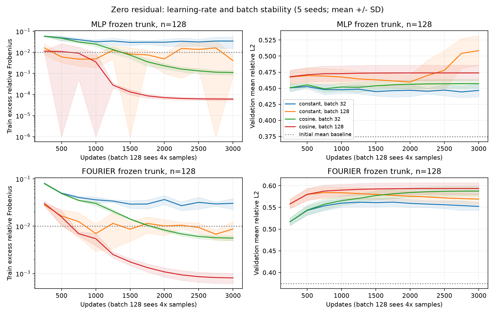

# An Exact A Posteriori Error Decomposition for Operator Learning: Conservation, Fluctuation, and the Limit of Branch Capacity

**Evidence-audited research draft v6 — 2026-10-28. Not a submitted manuscript.**

*Retitled 2026-10-28 for a computational-mathematics venue. The previous title, "Conserved
Means and Lost Fluctuations", read as a leaderboard claim about which architecture wins. The
contribution claimed here is the decomposition itself — Proposition 1 (an exact orthogonal
split) and Proposition 2 (a hard bound from the trunk span) — and the negative result and the
branch localisation that follow from it. The empirical threshold rule of section 5.8 is a
finding of the study, not a claimed theorem, and is labelled as such where it appears.*

The study covers six operator families — linear advection, Burgers at two viscosities,
diffusion-sorption, steady 2D Darcy, a three-field compressible system and a two-field
reaction-diffusion system — plus a physics-informed arm. "Family" counts a distinct PDEBench
dataset; Burgers at two viscosities and Darcy at two `beta` values are one family each, giving
eight setting-instances in total.

**Latest 2026-09-29 follow-up:** [mean/fluctuation decomposition](../docs/FLUCTUATION_DIAGNOSIS_V1.md).
The target spatial mean is a conserved quantity, so the previously reported "input-mean
baseline" is a conservation-law predictor rather than a strawman. Measuring fluctuation
skill separately shows that every DeepONet configuration in this repository scores at or
below the zero-fluctuation reference at forecast time 1.0, at every update budget tested,
while FNO explains about 65% of the per-sample fluctuation variance. The deficit is
horizon-dependent, not absolute: DeepONet has positive fluctuation skill at t=0.25 and
t=0.50 that decays to zero by t=1.00.

**Earlier 2026-09-29:** the [modal-shrinkage line](../docs/UNCERTAINTY_MODAL_V1.md) was
closed after its confirmation failed 0 of 12 comparisons against strong controls; those
experiments are recorded as a negative result and are not part of the current argument.

**2026-09-24 audit:** see [the historical archive](archive/pre_audit_20260924/main.md)
and [the pre-rewrite version](archive/pre_fluctuation_20260929/main.md). The study is
supervised operator learning, not a physics-informed training result.

## Abstract

On periodic Burgers the spatial mean of the solution is conserved, so a model can appear
competitive on relative L2 while predicting nothing beyond a conserved scalar. We separate
prediction error into a conserved-mean part and a fluctuation part and measure skill on
each, across six PDEBench operator families (linear advection, Burgers at two viscosities,
diffusion-sorption, steady 2D Darcy, a three-field compressible system and a two-field
reaction-diffusion system) and one physics-informed arm.
On PDEBench 1D Burgers (Nu0.001), forecasting t=0 to t=1.0, the conserved mean
carries 97.4% of the target energy and the fluctuation carries 23.7% of the per-sample
squared norm; the exact input mean alone already achieves 0.37577 mean relative L2.

The mean baseline turns out to be a property of the operator, not of the metric: on Darcy the
input-output mean correlation is -0.873 and the same construction gives 3.6843 instead of
0.37577, while within the CFD system mass and momentum are conserved to 1e-6 and 4e-4 but the
spatial mean of velocity alone is not (12%). The zero-fluctuation reference, by contrast,
needs no physics and carries over unchanged.

Against a zero-fluctuation reference, MLP DeepONet scores -0.0042 +- 0.0072 and Fourier
DeepONet -0.0934 +- 0.0886 in per-sample fluctuation R^2, while FNO scores +0.6503 +-
0.0222 on identical data, split and update budget. Across 175 reconstructed runs spanning
trunk architecture, whitening, mean lifting, zero initialization, learning-rate schedule,
batch size and training-subset size, no DeepONet configuration scores above zero. Raising
the budget from 1500 to 50000 updates does not help: per-sample fluctuation R^2 moves
-0.0042 -> -0.0640 -> -0.2470 -> -0.4157 for MLP DeepONet and total relative L2 never
improves (0.39357 / 0.39729 / 0.39311 / 0.42075), whereas FNO stays at +0.65 to +0.68 and
0.222 to 0.228.
The deficit is horizon-dependent and shared: over seven forecast horizons from t=0.10 to
t=2.00 the per-sample fluctuation R^2 of every architecture decays monotonically, and FNO
also falls below zero at t=2.00 (-0.0586 ± 0.2357). What differs is where each model
crosses zero, giving an interpolated **skill horizon** of about 0.86 for the Fourier-trunk
DeepONet, 0.98 for the MLP DeepONet and 1.94 for FNO. Parameter counts do not explain the
gap (Fourier DeepONet 131,969 versus FNO 136,481), and a wall-clock-matched control does
not either (DeepONet at 3500 updates, 14 s, scores -0.0057 against FNO's +0.6503 at
1500 updates, 14 s).

On linear advection, the same seven horizons show constant fluctuation energy (0.6446) and
**no** skill decay for any architecture (MLP +0.20 to +0.25, Fourier +0.93 to +0.95, FNO
+0.9994), so the decay tracks nonlinear spectral evolution rather than elapsed forecast
time. On diffusion-sorption, whose fluctuation energy decays from 0.7333 to 0.6506 without
approaching any threshold, no architecture decays either (all +0.998 to +1.000), supporting
the threshold form of the rule over "a longer forecast is harder". Empirically, a
fluctuation-energy threshold fitted on the first two PDEs, and never refitted, predicts the
sign of skill on both held-out families: 6 of 6 diffusion-sorption settings and 21 of 21 Burgers Nu=0.01
settings, including every threshold crossing, with predicted skill horizons 0.740 / 0.860 /
1.650 against measured 0.735 / 0.924 / 1.839, and 3 of 3 on a steady elliptic operator where
the input-output mean correlation is -0.873 and the mean baseline is consequently worthless.
The rule then fails on the three coupled fields of 1D compressible CFD (3 of 6, every positive
prediction wrong, thresholds not refitted) but holds on the two coupled fields of 2D
reaction-diffusion (4 of 4), so the failure is specific to that operator rather than to
coupling, and why it fails is left open.

An exact bound depending only on the trunk span (section 3.3) shows the constraint is the
branch, not the basis: the Fourier trunk's bound is +0.96 to +1.00 on both PDEs at every
horizon, including t = 2.00 where the achieved value is -0.3774, so the reachable set does
not shrink with horizon while the map onto it does.

Physics-informed
training, which uses no supervision at the target time, also fails to produce positive
fluctuation skill (-0.0003 and -0.2240), and the split shows it is not worse at the
fluctuation but at the conserved mean (mean share 0.1246 against 0.0334 supervised).

We claim a diagnostic decomposition — an exact split and a hard bound, both proved — and a
reproducible negative result, not a new architecture or optimizer and not a theorem for the
empirical rule. Six operator families are studied, most at a single parameter
setting (Burgers at two viscosities, Darcy at two `beta` values), with one physics-informed
arm and one split per family. Two of the six families are systems of equations, one of which
falsifies the threshold rule of section 5.8 and one of which confirms it, so systems are
covered but not settled.

## 1. Research question and contribution

Prior drafts of this study reported a dissociation: better offline basis quality and more
stable training fit did not produce better validation error. That statement is descriptive.
This version asks what the models actually predict, and answers it with a decomposition
that turns the dissociation into a measurement.

**Claimed contributions** (1-5, 7) are the decomposition, the negative result it measures,
and the localisations that follow. Item 6 is an **empirical regularity found by the study**,
reported with its falsification; it is not claimed as a theorem and is not what the
decomposition rests on.

1. A **mean/fluctuation decomposition**, stated as two propositions with proofs: an exact
   orthogonal split of squared error into a conserved-mean part and a fluctuation part
   (Proposition 1), and a hard upper bound on fluctuation skill depending only on the trunk
   span (Proposition 2). It supplies a defined zero-fluctuation reference and two skill
   measures that differ in how they weight samples, and it identifies the widely used
   "input spatial-mean baseline" as a conservation-law predictor.
2. A **negative result with a boundary rather than a mechanism**: on this protocol DeepONet
   reproduces a conserved quantity and has no per-sample fluctuation skill, and the skill it
   does have at short forecast horizons decays to zero as the horizon grows. The decay is
   quantified as an interpolated *skill horizon* that differs by architecture, and it is
   shown to track nonlinear spectral evolution rather than elapsed forecast time, because it
   is absent on linear advection (section 5.6.1).
3. A **budget control**: the near-zero skill is not undertraining, and additional updates
   make the per-sample measure worse while leaving total relative L2 flat.
4. A **measurement warning**: an energy-weighted skill measure can report improvement where
   the per-sample measure reports degradation. Both are reported throughout.
5. A **localisation of the binding constraint**. An exact upper bound on fluctuation skill
   that depends only on the trunk span (section 3.3) shows the reachable set does not shrink
   with forecast horizon while the map onto it does, so on this protocol the constraint is
   the branch — the input-to-coefficient mapping — and not the trunk basis. This qualifies
   rather than contradicts the basis-quality line of work in [2].
6. *(Empirical, not claimed as theory.)* A **prospective predictor, stated with its boundary**.
   An a-priori fluctuation-energy
   threshold, fitted on two scalar families and never refitted, predicts the sign of
   fluctuation skill on held-out settings: 52 of 55 preregistered sign predictions are
   correct, of which 27 of 30 are on settings that can actually discriminate and 5 of 6 are
   at the threshold boundary (sections 5.15-5.16). It fails on 1D compressible CFD (3 of 6,
   every prediction of positive skill wrong) and holds on 2D reaction-diffusion (4 of 4), so
   the failure is
   specific to that operator rather than to coupled fields. Both the confirmations and the
   falsification are reported; nothing was adjusted in response.
7. A **localisation of where physics-informed training fails**. With no supervision at the
   target time, the decomposition shows the deficit sits in the conserved mean and not in the
   fluctuation: the fluctuation share reaches the oracle value while the mean share rises by
   roughly a factor of four (section 5.11).

The linear-algebra identities below are standard, not new approximation theory. Neither
orthonormalization, zero-residual initialization, cosine decay, nor POD truncation is
claimed as a new method.

## 2. Related work and overlap

The architectures compared here are DeepONet [10] and the Fourier neural operator [11].
Neither is ours; the contribution is a decomposition applied to both.

Lee and Shin introduce two-step DeepONet training with trunk-first learning followed by
branch learning and orthonormalization [1]. Fixed-trunk training and basis
orthogonalization are therefore comparison points, not original contributions.

Williams et al. examine learned PI-DeepONet bases, singular-value/coefficient behavior and
transfer learning [2]. Our results qualify rather than contradict that line: trunk features
matter at short forecast horizons (the Fourier trunk scores +0.4248 against +0.1695 for the
MLP trunk at t=0.25) and stop mattering at t=1.00 (-0.0934 against -0.0042). Any claim
about trunk basis quality should state the forecast horizon.

Lu et al. compare DeepONet and FNO with practical extensions, including POD-DeepONet,
across multiple benchmarks [3]. Their result that architecture choice dominates on these
tasks is consistent with ours; our decomposition locates the difference in the fluctuation
component rather than in total error. Demo et al. learn a residual correction on a POD
basis [8], and Koike et al. study mode selection for sparse networks [9]; a modal-shrinkage
line in this repository was closed after failing its predeclared confirmation and is not
part of the current argument [see UNCERTAINTY_MODAL_V1.md](../docs/UNCERTAINTY_MODAL_V1.md).

PDEBench supplies the public data [4]. Zero-initialized residual mechanisms precede this
study, for example ReZero [5]; our zero final readout around an input-mean baseline is not
identical to ReZero's residual gates and no dynamical-isometry claim is made. Cosine
scheduling [6] and large-batch generalization studies [7] are established; we do not present
convergence-versus-generalization as a new general discovery, and no sharpness mechanism is
claimed. Khodakarami et al. analyse spectral bias in physics-informed and operator learning
and report that it is architecture dependent [12], which is consistent with, and independent
support for, the horizon-dependent trunk result in section 5.5.

## 3. Mean/fluctuation decomposition

Let `Y` and `P` in `R^{m x N}` be target and predicted fields for `m` trajectories on the
same `N`-point grid. Write the per-sample spatial mean as `bar(y)_j` and the fluctuation as
`Y_c = Y - bar(y) 1^T`, and similarly `P_c`.

### 3.1 An exact split of squared error

**Proposition 1 (orthogonal split).** For any `y_j, p_j \in R^N`, writing
`\bar y_j = N^{-1} 1^T y_j` and `y_{c,j} = y_j - \bar y_j 1`, and likewise for `p`,

\[
  \|p_j - y_j\|^2 = N(\bar p_j - \bar y_j)^2 + \|p_{c,j} - y_{c,j}\|^2 .
\]

Consequently, for any finite collection of samples and any prediction rule,

\[
  \underbrace{\mathbb{E}_j \frac{N(\bar p_j-\bar y_j)^2}{\|y_j\|^2}}_{\text{mean share}}
  +
  \underbrace{\mathbb{E}_j \frac{\|p_{c,j}-y_{c,j}\|^2}{\|y_j\|^2}}_{\text{fluctuation share}}
  = \mathbb{E}_j\,\mathrm{relL2}_j^2 .
\]

*Proof.* Write `p_j - y_j = (\bar p_j - \bar y_j)1 + (p_{c,j} - y_{c,j})`. The two summands
are orthogonal because `1^T (p_{c,j} - y_{c,j}) = 0` by construction, and
`\|(\bar p_j - \bar y_j)1\|^2 = N(\bar p_j - \bar y_j)^2`; Pythagoras gives the first
identity. Dividing by `\|y_j\|^2` and averaging over `j` gives the second. ∎

The split is an **identity**, not an attribution of cause: it holds for every prediction,
so it cannot by itself say why a model fails. Its content is that the two shares are
exactly additive and separately computable, which is what makes the localisation in
section 5 possible.

`scripts/diagnose_fluctuation.py` reports both shares and a closure term that the test
suite asserts to be zero to machine precision.

### 3.2 Two skill measures

| Measure | Definition | Dominated by |
|---|---|---|
| `fluctuation_r2` | `1 - sum_j \|\|p_c-y_c\|\|^2 / sum_j \|\|y_c\|\|^2` | high-energy samples |
| `fluctuation_r2_per_sample` | `1 - (fluctuation share) / (per-sample fluctuation energy)` | every sample equally |

Both are referenced to a **zero-fluctuation** predictor: any prediction whose fluctuation
is zero scores 0, including the exact-mean predictor and the all-zero predictor. `R^2` is
therefore invariant to the mean and measures fluctuation skill only; it is never a measure
of total accuracy. The manuscript's headline metric is a per-sample mean, so the per-sample
measure decides the claims, and the energy-weighted one is reported alongside because the
two can disagree in sign (section 5.4).

### 3.3 An exact upper bound from the trunk span

**Proposition 2 (trunk-span bound).** Let `Phi \in R^{N x p}` be the trunk feature matrix,
let `S = span([Phi, 1])` and let `P` be the orthogonal projector onto `S`. Write
`e = E_j \|y_{c,j}\|^2 / \|y_j\|^2` for the per-sample fluctuation energy. Then every
DeepONet output `p_j \in S` satisfies

\[
  R^2_{\text{per sample}} \;\le\; 1 - \frac{s_{\min}}{e},
  \qquad
  s_{\min} \;=\; \mathbb{E}_j \frac{\|(I-P)\,y_{c,j}\|^2}{\|y_j\|^2} .
\]

Moreover `s_{\min}` is attained by a per-sample oracle branch, so the bound is tight for
the given trunk and cannot be improved without changing `Phi`.

*Proof.* Since `1 \in S` and `p_j \in S`, the fluctuation `p_{c,j} = p_j - \bar p_j 1`
also lies in `S`. Decompose the target fluctuation orthogonally as
`y_{c,j} = P y_{c,j} + (I-P) y_{c,j}`. Then

\[
  p_{c,j} - y_{c,j} = \underbrace{(p_{c,j} - P y_{c,j})}_{\in S}
                      - \underbrace{(I-P) y_{c,j}}_{\in S^\perp},
\]

and the two terms are orthogonal, so by Pythagoras
`\|p_{c,j} - y_{c,j}\|^2 = \|p_{c,j} - P y_{c,j}\|^2 + \|(I-P)y_{c,j}\|^2 \ge
\|(I-P)y_{c,j}\|^2`. Dividing by `\|y_j\|^2` and averaging bounds the fluctuation share
below by `s_{\min}`, and `R^2_{\text{per sample}} = 1 - (\text{fluctuation share})/e` gives
the claim. For tightness, take `p_j = P y_{c,j} + c\,1 \in S` for any constant `c`; its
fluctuation is `P y_{c,j}`, which attains equality. Such a `p_j` is realised by choosing
the coefficient vector per sample, i.e. by an oracle branch. ∎

The bound is evaluated in section 5.7 on 50 trained trunks and is never violated. This is an
identity about the trunk's span, hence a **hard upper bound**, not an attribution.
It requires the trunk but no branch training. Comparing it with achieved skill separates two
failure modes: achieved near the bound means the trunk span is binding; achieved far below it
means the branch, that is the input-to-coefficient map, is binding. The gap is the amount
lost by the branch.

### 3.4 The mean baseline is a conservation-law predictor

For periodic Burgers, `d/dt int u dx = -[u^2/2] + nu[u_x] = 0`, so the spatial mean of the
target equals that of the input. Measured on the stored data:

| Split | corr(mean(x), mean(y)) | mean abs difference | mean abs target mean |
|---|---:|---:|---:|
| train | 1.000000 | 3.179e-05 | 4.959e-01 |
| validation | 1.000000 | 2.816e-05 | 5.097e-01 |
| test | 1.000000 | 2.977e-05 | 5.012e-01 |

Predicting the exact input mean and zero fluctuation therefore yields 0.37577 test mean
relative L2, with a fluctuation share of 0.22002 and a mean share of 0. The reported
"input spatial-mean baseline" is not a weak strawman: it is the best possible
conservation-law predictor, and matching it is a real, nontrivial requirement.

## 4. Data, controls and sequential study design

We use PDEBench's 1D Burgers Nu0.001 file, verified by SHA-256, with 10000 trajectories,
201 stored time layers and 1024 cell-centered spatial points. The primary task maps t=0 to
t=1.0 (index 100), with stride-four point sampling to 256 points and no anti-alias filter.

Every input file is pinned to a publisher-checked digest, recorded in each family's
`protocol.json`, and `src/public_benchmark.py` refuses to proceed if the file changes:

| File | Source | Identifier | Digest |
|---|---|---|---|
| `1D_Burgers_Sols_Nu0.001.hdf5` | HuggingFace `pdebench/Burgers` | git rev `97bf5bb5315b` | SHA-256 `afeeed1c40ce01d2...` |
| `1D_Advection_Sols_beta0.4.hdf5` | HuggingFace `pdebench/Advection` | git rev `33d90a245d98b` | SHA-256 `d973ff2bb3c2a5ed...` |
| `1D_Burgers_Sols_Nu0.01.hdf5` | DaRUS `darus-2986` v8 | datafile 281363 | MD5 `e6d9a4f62baf9a29...` |
| `1D_diff-sorp_NA_NA.h5` | DaRUS `darus-2986` v8 | datafile 133020 | MD5 `9d466d1213065619...` |
| `2D_DarcyFlow_beta1.0_Train.hdf5` | DaRUS `darus-2986` v8 | datafile 133219 | MD5 `81694ed31306ff2e...` |
| `2D_DarcyFlow_beta0.01_Train.hdf5` | DaRUS `darus-2986` v8 | datafile 133217 | MD5 `d05c287d4c0b7d31...` |
| `2D_DarcyFlow_beta10.0_Train.hdf5` | DaRUS `darus-2986` v8 | datafile 133220 | MD5 `a7f23cf8011fc211...` |
| `1D_CFD_Rand_Eta0.01_Zeta0.01_periodic_Train.hdf5` | DaRUS `darus-2986` v8 | datafile 164672 | MD5 `2fdd00138f1d7abc...` |
| `2D_diff-react_NA_NA.h5` | DaRUS `darus-2986` v8 | datafile 133017 | MD5 `b8d0b86064193195...` |

The Burgers SHA-256 was re-verified against the local file on 2026-10-08 and matches
exactly. Digests are truncated here for layout; full values are in `protocol.json` and in
`scripts/download_darus.py` and `scripts/download_pdebench.py`.
The generator uses epsilon/pi as the diffusion coefficient.

The initial split is 1000 training, 200 validation and 200 test trajectories, sampled with
split seed 20260922. Input/target scalar normalization uses training arrays only. DeepONet
uses 64 trunk features and three-layer, width-128 branch/trunk MLPs; the alternative trunk
uses fixed random Fourier input features. The FNO reference has four blocks, width 32 and
16 spectral modes. All training seeds are 0-4.

| Family | Run records | Main intervention | Evaluation status |
|---|---:|---|---|
| public_fixed_t1_v1 | 15 | MLP/Fourier DeepONet and FNO, 1500 updates | Train/validation/test; exploratory subset |
| public_coefficients_v1 | 40 | Conditioning x mean offset, 3000 branch updates | Same exploratory split |
| public_smallfit_v1 | 60 | n=32/128/1000 x random/zero readout | Train/validation only |
| public_stability_v1 | 40 | Constant/cosine LR x batch 32/128, n=128 | Train/validation only |
| public_steps5k_v1 | 15 | Same three architectures, 5000 updates | Train/validation/test |
| public_steps20k_v1 | 15 | Same three architectures, 20000 updates | Train/validation/test |
| public_horizon_t010_v1 | 15 | Target time 0.10, 1500 updates | Train/validation/test |
| public_horizon_t025_v1 | 15 | Target time 0.25, 1500 updates | Train/validation/test |
| public_horizon_t050_v1 | 15 | Target time 0.50, 1500 updates | Train/validation/test |
| public_horizon_t075_v1 | 15 | Target time 0.75, 1500 updates | Train/validation/test |
| public_horizon_t150_v1 | 15 | Target time 1.50, 1500 updates | Train/validation/test |
| public_horizon_t200_v1 | 15 | Target time 2.00, 1500 updates | Train/validation/test |
| public_wcmatch3500_v1 | 10 | DeepONet only, 3500 updates (wall-clock matched to FNO at 1500) | Train/validation/test |
| diffsorp_in020_t*_v1 | 90 | Diffusion-sorption, input layer 20, six targets t=125..500 | Train/validation/test |

The diffusion-sorption input is layer 20 rather than layer 0 because the stored initial
state is spatially constant for every sample; see section 5.6.2 and
[THIRD_PDE_DIFFSORP_V1.md](../docs/THIRD_PDE_DIFFSORP_V1.md). Its protocol and prediction
were committed before any run on that data.

Horizon variants are prepared by calling `src.public_benchmark.prepare` with
`time_index` 25 and 50 and the **same split seed and sizes**, so the trajectories are
identical and only the target time changes. This is a sensitivity check over forecast
horizon, **not a second PDE**.

These families were designed sequentially after inspecting preceding results. Protocols
were fixed before their respective launches, not preregistered as one independent
confirmatory study. Ten stability controls reproduce earlier results exactly and are not
independent replicates. The test split was exposed during early exploratory development.

Every number in sections 5.1-5.5 was recomputed from stored checkpoints by
`scripts/diagnose_fluctuation.py`, which compares each recomputed `mean_relative_l2`
against the value stored in that run's `result.json`. All recomputations reproduce their
stored metrics exactly (`max_abs_metric_difference = 0.00e+00` in every family), so the
decomposition is applied to a faithful reconstruction rather than an approximation.

## 5. Results

### 5.1 Representability is not operator accuracy

| Initial method | Test mean relative L2 (mean ± seed SD) |
|---|---:|
| Input spatial-mean baseline | 0.37577 |
| MLP DeepONet | 0.39357 ± 0.01014 |
| Fourier DeepONet | 0.41231 ± 0.01344 |
| FNO | 0.22835 ± 0.00680 |

Both initial DeepONets fail to beat the conservation-law baseline while FNO beats it by a
wide margin. Equal update counts do not match parameter counts or compute (section 5.9).

### 5.2 Fluctuation skill at t = 1.0

| Method | Test relL2 | R^2 (energy) | **R^2 (per sample)** | mean share | fluctuation share |
|---|---:|---:|---:|---:|---:|
| oracle input mean | 0.37577 | 0.0000 | **0.0000** | 0.0000 | 0.2200 |
| MLP DeepONet | 0.39357 | -0.0056 ± 0.0094 | **-0.0042 ± 0.0072** | 0.0180 | 0.2209 |
| Fourier DeepONet | 0.41231 | -0.0124 ± 0.0356 | **-0.0934 ± 0.0886** | 0.0340 | 0.2406 |
| FNO | 0.22835 | +0.6282 ± 0.0187 | **+0.6503 ± 0.0222** | 0.0023 | 0.0769 |

MLP DeepONet's fluctuation share (0.2209) is indistinguishable from the zero-fluctuation
reference (0.2200): at 1500 updates it predicts the fluctuation no better than not
predicting it at all, and its remaining error over the oracle comes from the mean
component. FNO reduces the fluctuation share by 65% and its mean share by a further order
of magnitude.

### 5.3 No intervention produces positive fluctuation skill

`scripts/diagnose_fluctuation.py` recomputed all 175 stored runs of the original four
families plus the 5k and 20k families. Per-sample fluctuation R^2 by family (mean ± SD
over the runs in that family):

| Family | Split | MLP DeepONet | Fourier DeepONet |
|---|---|---:|---:|
| public_fixed_t1_v1 (1500) | test | -0.0042 ± 0.0072 | -0.0934 ± 0.0886 |
| public_coefficients_v1 (3000) | test | -0.1286 ± 0.1054 | -0.3030 ± 0.1558 |
| public_stability_v1 (3000) | validation | -0.6438 ± 0.2273 | -1.4062 ± 0.1736 |
| public_scale1000_v1 (3000) | validation | -0.0354 ± 0.0556 | -0.3181 ± 0.0895 |
| public_smallfit_v1 (3000) | validation | -2.2911 ± 4.0722 | -5.5548 ± 8.7244 |

Not one configuration, across trunk architecture, whitening, mean lifting, zero
initialization, schedule, batch size and training-subset size, scores above the
zero-fluctuation reference. Interventions that improve fitting score worse than the
end-to-end baselines, which is the dissociation reported in earlier drafts, now measured on
the component that causes it.

### 5.4 More updates do not help, and hurt the per-sample measure

| Budget | Method | Test relL2 | R^2 (energy) | **R^2 (per sample)** |
|---|---|---:|---:|---:|
| 1500 | MLP DeepONet | 0.39357 | -0.0056 ± 0.0094 | **-0.0042 ± 0.0072** |
| 1500 | Fourier DeepONet | 0.41231 | -0.0124 ± 0.0356 | **-0.0934 ± 0.0886** |
| 1500 | FNO | 0.22835 | +0.6282 ± 0.0187 | **+0.6503 ± 0.0222** |
| 5000 | MLP DeepONet | 0.39729 | +0.0165 ± 0.0159 | **-0.0640 ± 0.0503** |
| 5000 | Fourier DeepONet | 0.40250 | +0.0175 ± 0.0450 | **-0.1272 ± 0.0787** |
| 5000 | FNO | 0.21619 | +0.5864 ± 0.0166 | **+0.6830 ± 0.0325** |
| 20000 | MLP DeepONet | 0.39311 | +0.2126 ± 0.0557 | **-0.2470 ± 0.1304** |
| 20000 | Fourier DeepONet | 0.47689 | -0.1623 ± 0.0609 | **-0.8037 ± 0.2393** |
| 20000 | FNO | 0.22243 | +0.5538 ± 0.0139 | **+0.6660 ± 0.0170** |
| 50000 | MLP DeepONet | 0.42075 | +0.1496 ± 0.0484 | **-0.4157 ± 0.1901** |
| 50000 | Fourier DeepONet | 0.51959 | -0.2974 ± 0.0631 | **-1.1099 ± 0.2875** |
| 50000 | FNO | 0.22190 | +0.5661 ± 0.0131 | **+0.6659 ± 0.0148** |

Two readings, and the second is the one that matters:

1. **Undertraining is not the explanation.** Across a 33x budget range the total relative
   L2 of MLP DeepONet never improves (0.39357 / 0.39729 / 0.39311 / 0.42075) and FNO is
   stable (0.22835 / 0.21619 / 0.22243 / 0.22190). The ranking never changes, and at the
   largest budget DeepONet is worse, not better.
2. **The energy-weighted measure would have produced a false positive.** At 20000 updates
   MLP DeepONet reads +0.2126 energy-weighted but -0.2470 per sample: improvement is
   concentrated in high-energy samples while typical samples get worse. Since the
   manuscript's metric is a per-sample mean, the per-sample measure decides the claim and
   the energy-weighted one is reported only alongside it.

The normalized mean error also grows with budget for MLP DeepONet (0.081 -> 0.076 -> 0.111
-> 0.138) while staying at 0.024-0.034 for FNO, so extra updates trade conserved-mean
accuracy for fluctuation fitting with no net gain.

### 5.5 A skill horizon: the deficit is horizon-dependent and shared

Same 1500-update budget, same trajectories and split, only the target time changes. Seven
horizons are run to trace the decay rather than assert a trend from three points.

| t | fluctuation energy | MLP DeepONet | Fourier DeepONet | FNO |
|---:|---:|---:|---:|---:|
| 0.10 | 0.5939 | +0.2199 ± 0.0554 | +0.6390 ± 0.0142 | +0.9859 ± 0.0047 |
| 0.25 | 0.4785 | +0.1695 ± 0.0154 | +0.4248 ± 0.0168 | +0.9474 ± 0.0058 |
| 0.50 | 0.3580 | +0.1238 ± 0.0137 | +0.2510 ± 0.0389 | +0.8369 ± 0.0075 |
| 0.75 | 0.2841 | +0.0539 ± 0.0023 | +0.0675 ± 0.0701 | +0.7378 ± 0.0089 |
| 1.00 | 0.2367 | -0.0042 ± 0.0072 | -0.0934 ± 0.0886 | +0.6503 ± 0.0222 |
| 1.50 | 0.1786 | -0.0813 ± 0.0261 | -0.4064 ± 0.1757 | +0.4051 ± 0.0217 |
| 2.00 | 0.1428 | -0.0918 ± 0.0491 | -0.3774 ± 0.0571 | -0.0586 ± 0.2357 |

(per-sample R^2 on the test split.)

**All three architectures lose their fluctuation skill as the horizon grows, and FNO loses
it too at t = 2.00.** The deficit is therefore a property of the task's difficulty first
and of the architecture second: what differs is *where* each architecture crosses zero.
Interpolating linearly between the bracketing horizons gives a **skill horizon** at which
per-sample fluctuation R^2 reaches zero:

| Model | bracketing horizons | **skill horizon (interpolated)** |
|---|---|---:|
| Fourier DeepONet | 0.75 (+0.0675) to 1.00 (-0.0934) | **~0.86** |
| MLP DeepONet | 0.75 (+0.0539) to 1.00 (-0.0042) | **~0.98** |
| FNO | 1.50 (+0.4051) to 2.00 (-0.0586) | **~1.94** |

FNO's skill horizon is about 2.0x that of MLP DeepONet and 2.3x that of the Fourier-trunk
variant. Note that the Fourier trunk is the better trunk at short horizons (+0.6390 against
+0.2199 at t = 0.10) and the worse one at long horizons (-0.3774 against -0.0918 at
t = 2.00), so trunk-feature claims must state the horizon; this qualifies, rather than
contradicts, the basis-quality line of work in [2].

The fluctuation energy fraction decreases monotonically over the same horizons
(0.5939 -> 0.1428) and can be computed from the data before any training, so it is an
a-priori monotone proxy for horizon difficulty. It does **not** by itself predict skill
across architectures: at a fixed fluctuation energy the three models differ by up to 0.8 in
R^2. Skill is monotone in the horizon within each architecture, but the curve itself is set
by the architecture.

### 5.6 Other operators and a viscosity ladder

Two controls were run at the same 1500-update budget, seeds, architectures and split. Both
use `scripts/prepare_*_horizons.py`, which reuse the extraction and splitting helpers
unchanged rather than editing `prepare()`, because that function pins the Burgers digest and
would change `source_hash()` in every run identity. The layouts are identical, so training
and diagnostics run unmodified, and all recomputations reproduce stored metrics exactly.

### 5.6.1 Linear advection

The Burgers result could be a generic consequence of forecasting further into the future
rather than a consequence of nonlinear evolution. To separate these, the same seven
horizons, budget, seeds and architectures were run on PDEBench 1D **linear advection**
(beta = 0.4, periodic), whose solution is a pure translation of the initial field.

| t | fluctuation energy | MLP DeepONet | Fourier DeepONet | FNO |
|---:|---:|---:|---:|---:|
| 0.10 | 0.6446 | +0.2531 ± 0.0900 | +0.9228 ± 0.0354 | +0.9994 ± 0.0000 |
| 0.25 | 0.6446 | +0.2427 ± 0.0318 | +0.9415 ± 0.0171 | +0.9994 ± 0.0001 |
| 0.50 | 0.6446 | +0.2058 ± 0.0616 | +0.9466 ± 0.0147 | +0.9994 ± 0.0000 |
| 0.75 | 0.6446 | +0.2295 ± 0.0423 | +0.9278 ± 0.0310 | +0.9994 ± 0.0000 |
| 1.00 | 0.6446 | +0.1817 ± 0.0092 | +0.9424 ± 0.0180 | +0.9994 ± 0.0000 |
| 1.50 | 0.6446 | +0.2390 ± 0.0309 | +0.9456 ± 0.0134 | +0.9994 ± 0.0000 |
| 2.00 | 0.6446 | +0.2047 ± 0.0031 | +0.9354 ± 0.0178 | +0.9994 ± 0.0000 |

Two things change at once, and both matter:

1. **Fluctuation energy is constant across horizons** (0.6446 at every t), as it must be
   for pure translation, against a monotone decay from 0.5939 to 0.1428 on Burgers.
2. **No architecture shows a skill horizon.** MLP DeepONet stays near +0.20 to +0.25,
   Fourier DeepONet near +0.93 to +0.95 and FNO at +0.9994, with no trend in t.

So the decay measured on Burgers is not a generic effect of forecasting further ahead. It
appears in the problem whose fluctuation spectrum evolves nonlinearly and is absent in the
problem where the fluctuation is merely transported. This is the control that makes the
skill horizon interpretable rather than descriptive.

It also sharpens the trunk-feature question. On advection the Fourier trunk is
dramatically better than the MLP trunk (+0.94 against +0.21), consistent with translation
being a phase shift in a Fourier basis; on Burgers that advantage is present at t=0.10
(+0.6390 against +0.2199) and reverses by t=2.00 (-0.3774 against -0.0918). A trunk that is
well matched to the *linear* part of the operator is not automatically well matched once
nonlinear steepening dominates.

### 5.6.2 A third class: diffusion-dominated, dissipative

PDEBench 1D diffusion-sorption (`t` in [0, 500], 101 layers) is parabolic and dissipative
with no shocks and no translation. **Its stored `t = 0` state is spatially constant for
every sample** (spatial standard deviation below 4e-8; only the constant value varies), so
it carries one degree of freedom and would make the task "generate a field from a scalar".
The input is therefore layer 20 (`t = 100`, spatial standard deviation 0.2390) and all six
targets are strictly later. This caveat is recorded in every protocol file; it was found by
checking the data, and an earlier preparation bug that silently made one horizon an identity
map was caught by the same check.

| t | fluctuation energy | MLP DeepONet | Fourier DeepONet | FNO |
|---:|---:|---:|---:|---:|
| 125 | 0.7333 | +0.9983 ± 0.0014 | +0.9998 ± 0.0003 | +1.0000 ± 0.0000 |
| 200 | 0.7173 | +0.9990 ± 0.0010 | +1.0000 ± 0.0000 | +1.0000 ± 0.0000 |
| 275 | 0.7004 | +0.9988 ± 0.0012 | +1.0000 ± 0.0000 | +1.0000 ± 0.0000 |
| 350 | 0.6834 | +0.9997 ± 0.0002 | +0.9999 ± 0.0001 | +1.0000 ± 0.0000 |
| 425 | 0.6667 | +0.9998 ± 0.0001 | +0.9999 ± 0.0001 | +1.0000 ± 0.0000 |
| 500 | 0.6506 | +0.9999 ± 0.0001 | +0.9999 ± 0.0001 | +1.0000 ± 0.0000 |

No architecture shows any skill decay. The fluctuation energy *does* decay here (0.7333 to
0.6506), just as it does on Burgers, yet no zero crossing occurs, because the energy never
approaches any architecture's threshold. That asymmetry is the strongest evidence for the
threshold form of the rule in section 5.8 as opposed to "a longer forecast is harder".

**Stated weakness:** 99% of the target fluctuation energy lies in a single spatial mode at
every horizon, so all three models score essentially 1.000 and the setting does not
discriminate between architectures. A confirmation here is weak support; a falsification
would have been strong evidence. No setting on this PDE lies near a threshold, so the rule's
boundary remains untested out of sample.

### 5.6.3 A viscosity ladder: the rule at its boundary

Section 5.6.2 confirms the rule where every model saturates, which is easy. A stronger test
needs settings that straddle a threshold. Burgers at `Nu = 0.01`, ten times the viscosity,
dissipates faster, so the fluctuation energy crosses the thresholds earlier. Its protocol and
all 21 sign predictions were committed before any run on that data
([VISCOSITY_NU001_V1.md](../docs/VISCOSITY_NU001_V1.md)); the thresholds are those fitted on
Nu0.001 plus advection and were not refitted.

| t | fluctuation energy | MLP DeepONet | Fourier DeepONet | FNO | predicted |
|---:|---:|---:|---:|---:|---|
| 0.10 | 0.5661 | +0.2346 ± 0.0521 | +0.6891 ± 0.0215 | +0.9975 ± 0.0004 | + / + / + |
| 0.25 | 0.4507 | +0.1737 ± 0.0126 | +0.4392 ± 0.0336 | +0.9800 ± 0.0038 | + / + / + |
| 0.50 | 0.3320 | +0.1500 ± 0.0152 | +0.1878 ± 0.0747 | +0.9519 ± 0.0060 | + / + / + |
| 0.75 | 0.2596 | +0.0628 ± 0.0215 | -0.0122 ± 0.0795 | +0.8751 ± 0.0126 | + / - / + |
| 1.00 | 0.2131 | -0.0273 ± 0.0159 | -0.2443 ± 0.1387 | +0.8072 ± 0.0335 | - / - / + |
| 1.50 | 0.1559 | -0.2387 ± 0.0258 | -0.8703 ± 0.4734 | +0.4670 ± 0.0419 | - / - / + |
| 2.00 | 0.1217 | -0.2972 ± 0.1299 | -1.1128 ± 0.3465 | -0.2219 ± 0.4127 | - / - / - |

**All 21 predictions are correct** (7/7 per architecture), including every crossing. The
interpolated skill horizons are:

| Model | predicted from the rule | measured here | measured at Nu=0.001 | absolute error |
|---|---:|---:|---:|---:|
| Fourier DeepONet | 0.740 | **0.735** | 0.860 | 0.005 |
| MLP DeepONet | 0.860 | **0.924** | 0.980 | 0.064 |
| FNO | 1.650 | **1.839** | 1.940 | 0.189 |

All three are shorter than at Nu=0.001, as predicted. The error grows with horizon length,
which is what linear interpolation over a coarse grid implies at the far end of the ladder.
This is a parameter ladder on one operator, so it shows the rule tracks a physical parameter;
it does not by itself show the rule transfers to a new operator class.

### 5.6.4 A steady elliptic operator, and what it says about the mean baseline

PDEBench 2D Darcy is steady, elliptic and two-dimensional: `nu (10000,128,128)` is a
coefficient field and `tensor (10000,1,128,128)` the solution, subsampled with stride 2 to
64x64. It differs from every other family in three independent ways, and its protocol and
prediction were committed before any run
([DARCY_ELLIPTIC_V1.md](../docs/DARCY_ELLIPTIC_V1.md)). Two new files supply the 2D
machinery (`src/fno2d.py`, `scripts/run_darcy_benchmark.py`); `src/fno.py` was not edited
because it is hashed into every existing run identity.

| Model | test relL2 | **R^2 per sample** | R^2 energy-weighted |
|---|---:|---:|---:|
| MLP DeepONet | 0.26353 | +0.7614 ± 0.0160 | +0.8081 |
| Fourier DeepONet | 0.16450 | +0.9153 ± 0.0079 | +0.9333 |
| FNO | 0.08330 | +0.9790 ± 0.0009 | +0.9731 |

The a-priori fluctuation energy is 0.4964, above every threshold, so positive skill was
predicted for all three: **3 of 3 correct**. The rule therefore transfers from 1D evolution
problems to a steady elliptic operator with the thresholds unchanged.

**This family also settles what the mean baseline means.** The input-output mean correlation
is **-0.873**, so no conservation law links them, and the input-spatial-mean predictor gives
a test relative L2 of **3.6843** — far worse than useless. On Burgers the identical
construction was a genuine conservation-law predictor at 0.37577. The comparison shows that
the standing of the mean baseline is a property of the operator's physics, not of the metric
or of the architecture. The zero-fluctuation reference, by contrast, needs no physics: it is
well defined for any field, which is why the skill measure carries over unchanged.

### 5.7 The binding constraint is the branch, not the trunk

Section 3.3 gives an exact upper bound on fluctuation skill that depends only on the trunk
span. `scripts/skill_bound.py` evaluates it on the trained trunks of five settings, using
the same rcond as the projection audit.

| Setting | Trunk | basis rank | **bound** | achieved | **branch gap** |
|---|---|---:|---:|---:|---:|
| Advection t = 1.00 | Fourier | 62.8 | +1.0000 ± 0.0000 | +0.9424 | **0.058** |
| Advection t = 2.00 | Fourier | 62.2 | +0.9999 ± 0.0000 | +0.9354 | **0.065** |
| Burgers t = 0.25 | Fourier | 42.6 | +0.9590 ± 0.0044 | +0.4248 | 0.534 |
| Burgers t = 1.00 | Fourier | 39.4 | +0.9737 ± 0.0062 | -0.0934 | 1.067 |
| Burgers t = 2.00 | Fourier | 39.6 | +0.9845 ± 0.0045 | -0.3774 | 1.362 |
| Advection t = 1.00 | MLP | 7.4 | +0.5785 ± 0.0458 | +0.1817 | 0.397 |
| Burgers t = 0.25 | MLP | 6.8 | +0.5855 ± 0.0459 | +0.1695 | 0.416 |
| Burgers t = 1.00 | MLP | 4.4 | +0.5072 ± 0.0516 | -0.0042 | 0.511 |
| Burgers t = 2.00 | MLP | 4.2 | +0.5180 ± 0.0462 | -0.0918 | 0.610 |

The bound is never violated in any of the 50 evaluated trunks, which is the empirical check
that the statement in section 3.3 holds on real checkpoints and not only on paper.

Three consequences:

1. **The Fourier trunk's span is not the constraint anywhere.** Its bound is 0.96 to 1.00 on
   *both* PDEs and at *every* horizon, including t = 2.00 where the achieved value is
   -0.3774. The trunk could represent the fluctuation almost perfectly; the model simply
   does not produce it.
2. **The branch gap is what tracks the difficulty.** On advection with a Fourier trunk the
   branch loses only 0.06, i.e. it nearly attains the bound, which is consistent with
   translation being a phase shift that a linear readout on Fourier modes can express. On
   Burgers the same trunk loses 0.53 at t = 0.25 and 1.36 at t = 2.00.
3. **The MLP trunk is additionally span-limited but not primarily so.** Its bound is lower
   (0.51 to 0.59) because the trained basis collapses to about 4 to 7 effective dimensions,
   yet the achieved skill is still far below even that reduced bound. So both trunks fail
   mainly through the branch.

This is what the skill horizon reflects: the reachable set does not shrink with horizon,
the map onto it does. It is a statement about where the loss occurs, not a causal mechanism
for why.

### 5.8 An empirical boundary, not a theorem

> **Status of this section.** Everything below is an empirical regularity observed in this
> study. It is not derived from Proposition 1 or 2, no theorem is claimed for it, and the
> decomposition in section 3 does not depend on it. It is included because it is the only part
> of the study that makes a *prospective* prediction and because its failure on one operator is
> informative; readers interested only in the decomposition can skip to section 5.9 without
> loss of continuity. The thresholds are numbers fitted on two families, not derived
> quantities, and the rule is stated with the operator on which it fails.

The skill horizon is measured after training. A diagnostic method should predict it before.
`scripts/predict_skill_horizon.py` computes five statistics from the **training split only**,
with no model and no test targets, over all 20 settings (Burgers 7, advection 7,
diffusion-sorption 6), and correlates them with the measured skill.

| Statistic | MLP | Fourier | FNO |
|---|---:|---:|---:|
| fluctuation energy fraction | **0.922** | **0.916** | **0.922** |
| POD modes for 99% energy | -0.812 | -0.824 | -0.857 |
| spectral effective rank | -0.693 | -0.768 | -0.752 |
| input-to-target subspace distance | -0.764 | -0.820 | -0.863 |
| spectral decay exponent | -0.433 | -0.472 | -0.472 |

(Spearman correlation with measured per-sample R^2, pooled over all three PDEs, n = 20.
Within Burgers alone the correlation of fluctuation energy with skill is 1.000 for MLP and
FNO and 0.964 for Fourier, n = 7.)

**The threshold rule now has three out-of-sample tests, and it passes all three.** The thresholds
are interpolated from Burgers Nu0.001 and advection only — about 0.248 for MLP DeepONet,
0.273 for Fourier DeepONet and 0.150 for FNO — and then applied unchanged to:

* the six held-out diffusion-sorption settings: 6/6 correct for each architecture;
* the 21 held-out Burgers Nu=0.01 settings: 21/21 correct (7/7 per architecture), with
  predicted skill horizons 0.740 / 0.860 / 1.650 against measured 0.735 / 0.924 / 1.839
  (section 5.6.3);
* the 3 held-out steady elliptic Darcy settings: 3/3 correct (section 5.6.4).

The viscosity ladder is the strongest of the three because its settings straddle the
thresholds rather than lying far from them; Darcy is the only test on a non-evolution
operator.

**The rule then fails on one system and holds on another.** On the three coupled fields of 1D
compressible CFD the sign accuracy is 3 of 6, with every prediction of positive skill wrong
(section 5.13). On the two coupled fields of 2D reaction-diffusion it is 4 of 4 (section
5.14). The thresholds were not refitted in either case. The failure is therefore **specific to
compressible flow** rather than to coupling, and the rule is stated as holding on every
scalar family tested plus 2D reaction-diffusion. Why CFD fails is not established: the two
systems differ simultaneously in PDE type, fluctuation energy and component count.

Three qualifications still limit the claim:

1. **The pooled correlations are inflated by clustering.** Within advection the fluctuation
   energy is constant and within diffusion-sorption all models saturate, so neither
   contributes within-PDE ordering; the pooled values largely reflect the separation of
   clusters. The trustworthy statement is the within-Burgers monotonicity.
2. **The out-of-sample confirmation is weak.** As predeclared in
   [THIRD_PDE_DIFFSORP_V1.md](../docs/THIRD_PDE_DIFFSORP_V1.md), every model scores
   essentially 1.000 on diffusion-sorption, so those settings do not discriminate. They
   confirm the rule where it is easy and do not probe it where it is hard.
3. **What remains untested.** The rule now has three out-of-sample confirmations, but only
   the viscosity ladder probes its boundary, and no held-out setting on the non-evolution
   operator lies near a threshold. Whether the specific numeric thresholds transfer to a
   steady operator at its boundary is therefore still open, and no refitting was done to
   make them appear to.

One hypothesis was tested and failed: the input-to-target subspace distance was expected to
grow with horizon where the fluctuation spectrum evolves. It does the opposite on Burgers
(0.0231 at t = 0.10 falling to 0.0079 at t = 2.00), because smoother targets are *easier*
for the leading input modes to capture. It is retained as a negative result.

### 5.9 Compute and parameter budget

Recorded optimizer time (excluding evaluation and checkpointing) and parameter counts:

| Model | parameters | ms per update | 1500 | 5000 | 20000 | 50000 |
|---|---:|---:|---:|---:|---:|---:|
| MLP DeepONet | 115,713 | 2.93-4.25 | 6 | 20 | 85 | 146 |
| Fourier DeepONet | 131,969 | 3.67-4.20 | 6 | 18 | 83 | 210 |
| FNO | 136,481 | 9.02-9.32 | 14 | 46 | 180 | 454 |

(wall-clock seconds of optimizer time, excluding evaluation and checkpointing)

FNO costs about 2.2x more wall-clock per update, so an equal-update comparison gives FNO
more compute, not less. Parameter counts are within 18% (Fourier DeepONet has 97% of FNO's
parameters). A compute-favoured comparison is therefore available and goes the other way:
MLP DeepONet trained for 50000 updates (146 s) scores -0.4157 per-sample fluctuation R^2 and
0.42075 relative L2, while FNO trained for 1500 updates (14 s) scores +0.6503 and 0.22835.
DeepONet receives roughly 10x the compute and remains worse by more than 1.0 in R^2.

Update counts are only a proxy for work, so the work itself was measured. `scripts/
measure_flops.py` counts forward-plus-backward FLOPs per training step with
`torch.utils.flop_counter` on the actual models:

| Model | parameters | FLOPs per step | FLOPs for 1500 steps |
|---|---:|---:|---:|
| MLP DeepONet | 115,713 | 7.82e7 | 4.02e11 |
| Fourier DeepONet | 131,969 | 9.49e7 | 4.02e11 (at 4233 steps) |
| FNO | 136,481 | 2.68e8 | 4.02e11 (at 1500 steps) |

**Caveat that makes the comparison conservative:** no FFT-related op was counted, so the
FNO total is a **lower bound** and the FLOP-matched DeepONet budgets (5135 and 4233 updates,
chosen to give FNO's 4.02e11) are correspondingly **lower bounds** on truly equal work.
DeepONet is therefore given less work than FNO actually performed.

A directly wall-clock-matched comparison agrees: DeepONet at 3500 updates takes 14.0 s on
average, matching FNO at 1500 updates (14 s), and scores -0.0057 ± 0.0218 (MLP) and
-0.0884 ± 0.0504 (Fourier) against FNO's +0.6503 ± 0.0222.

At the FLOP-matched budgets the result is the same in sign and larger in magnitude:

| Model | matched updates | test relL2 | **R^2 per sample** |
|---|---:|---:|---:|
| FNO | 1500 | 0.22835 | **+0.6503 ± 0.0222** |
| MLP DeepONet | 5135 | 0.39091 | **-0.0475 ± 0.0826** |
| Fourier DeepONet | 4233 | 0.40781 | **-0.1148 ± 0.0418** |

And at 3.9 times that FLOP budget (20000 updates) MLP DeepONet is still -0.2470. The gap is
therefore not explained by DeepONet receiving less compute, fewer updates, or fewer
parameters; it survives an equal-work comparison and gets worse when DeepONet is given
almost four times the work.

FFT work is not registered by the counter, so an analytic estimate was added: about
`2.5 n log2(n)` per real transform, counted four times per spectral layer for the forward and
the backward. That raises FNO from 2.68e8 to 3.52e8 FLOPs per step and the matched DeepONet
budgets from 5135 and 4233 to **6744 and 5559** updates. Re-running at those budgets gives
-0.0892 ± 0.1193 for MLP and -0.2139 ± 0.0683 for Fourier, so the conclusion is unchanged and
the margin is larger.

What remains is that the FFT term is an **estimate**, not a measurement, so equal *estimated*
FLOPs are still not provably equal real work. The estimate is reported separately from the
measured dense count so a reader can use either, and since the estimated part belongs to FNO
the direction of any error favours FNO.

### 5.10 Fitting interventions stabilize training without improving validation

| Trunk | LR | Batch | Final train excess | Stable seeds | Validation relative L2 (mean ± SD) |
|---|---|---:|---:|---:|---:|
| MLP | constant | 32 | 0.034534 | 0/5 | 0.44657 ± 0.00981 |
| MLP | constant | 128 | 0.004113 | 0/5 | 0.50846 ± 0.02313 |
| MLP | cosine | 32 | 0.001117 | 5/5 | 0.45708 ± 0.00689 |
| MLP | cosine | 128 | 0.000061 | 5/5 | 0.47377 ± 0.01201 |
| Fourier | constant | 32 | 0.030453 | 0/5 | 0.55232 ± 0.00913 |
| Fourier | constant | 128 | 0.008727 | 1/5 | 0.56900 ± 0.01195 |
| Fourier | cosine | 32 | 0.005602 | 5/5 | 0.58755 ± 0.01125 |
| Fourier | cosine | 128 | 0.000809 | 5/5 | 0.59345 ± 0.01332 |

Cosine decay yields stable final-tail fitting in 20/20 runs; constant learning rates do so
in 0/10 with batch 32 and 1/10 with batch 128. At batch 32 decay nevertheless worsens
validation for every paired seed. Section 5.3 gives the reason these runs can be made to
fit without improving: fitting is measured on the full field, whose error is dominated by
the conserved mean, while the fluctuation component remains unexplained.

Full-batch trials process four times as many examples at equal updates. Recorded update
times exclude evaluation and checkpointing; equal update counts are not equal compute.

### 5.11 A physics-informed arm, and where it fails

Every result above is supervised. This arm repeats the decomposition on genuinely
physics-informed training: the loss is the initial condition, the PDE residual
`u_t + u u_x - nu u_xx`, and periodicity, with **no supervision at the target time**
([PHYSICS_INFORMED_V1.md](../docs/PHYSICS_INFORMED_V1.md)). The trunk therefore takes
`(t, x)` rather than `x`.

A residual can only be written once the data is known to satisfy the equation, so the
coefficient was measured first (`scripts/estimate_burgers_nu.py`): on Nu = 0.01 the fitted
convection coefficient is 0.995 and the fitted diffusion is 3.140e-3 against
`nu_file / pi` = 3.183e-3, with R^2 = 0.9999, whereas Nu = 0.001 fits poorly (R^2 = 0.79)
because its shocks are under-resolved. Only Nu = 0.01 is used, with `nu = 3.083e-3`
preregistered and not tuned on any model output.

| Model | relL2 | mean share | fluctuation share | **R^2 per sample** |
|---|---:|---:|---:|---:|
| oracle (exact mean, zero fluctuation) | 0.32623 | 0.0000 | 0.1875 | 0.0000 |
| supervised MLP DeepONet | 0.36238 | 0.0334 | 0.1926 | -0.0273 ± 0.0159 |
| **physics-informed MLP DeepONet** | 0.43613 | **0.1246** | 0.1875 | **-0.0003 ± 0.0100** |
| supervised Fourier DeepONet | 0.38921 | 0.0510 | 0.2333 | -0.2443 ± 0.1387 |
| **physics-informed Fourier DeepONet** | 0.48460 | **0.1736** | 0.2295 | **-0.2240 ± 0.0849** |

The PDE loss fell from about 1e-1 to 6e-5, so this is a converged residual and not an
unconverged run.

**Physics-informed training does not produce positive fluctuation skill**, which is what
section 5.7 predicts: the residual changes what the branch is asked to fit, not its ability
to represent the input-to-coefficient map. The branch-bottleneck claim survives untouched.

The decomposition says something more precise than "physics does not help". For the MLP
trunk, physics-informed training reaches a fluctuation share of 0.1875 — **exactly** the
oracle's — giving R^2 = -0.0003, marginally better than supervised training's -0.0273. Its
total error is nevertheless much worse, and the split localises why: the **mean share rises
from 0.0334 to 0.1246**. With no target-time supervision the conserved mean has to emerge
from the residual and the initial condition alone, and it does not. Physics-informed training
here is not worse at the fluctuation; it is worse at the conservation law.

The arm was then extended to a shorter horizon, `T = 0.5`, chosen because **supervised
training succeeds there** (MLP +0.1500, Fourier +0.1878), with the prediction preregistered
that physics-informed training would still fail to reach positive skill.

| Model | relL2 | mean share | fluctuation share | **R^2 per sample** |
|---|---:|---:|---:|---:|
| oracle (exact mean, zero fluctuation) | 0.43080 | 0.0000 | 0.2748 | 0.0000 |
| supervised MLP DeepONet | 0.41646 | 0.0169 | 0.2336 | +0.1500 ± 0.0152 |
| supervised Fourier DeepONet | 0.40288 | 0.0327 | 0.2232 | +0.1878 ± 0.0747 |
| **physics-informed MLP DeepONet** | 0.49731 | **0.0707** | 0.2724 | **+0.0088 ± 0.0054** |
| **physics-informed Fourier DeepONet** | 0.52047 | **0.1565** | 0.2606 | **+0.0516 ± 0.0364** |

**The preregistered prediction was wrong and is reported as falsified**: physics-informed
training does reach positive skill at this horizon, +0.0088 and +0.0516. The loss weights and
the coefficient were not adjusted in response.

What survives is the comparison and the localisation. Physics-informed skill is 17 times
lower than supervised for the MLP trunk and 4 times lower for the Fourier trunk, and the
**mean share is again where the damage is** (0.071 and 0.157 against 0.017 and 0.033), the
same pattern as at `T = 1.0`. The corrected statement is therefore weaker and more accurate
than the preregistered one: at a horizon where supervision succeeds, physics-informed training
also succeeds but barely, and its deficit stays concentrated in the conserved mean rather than
in the fluctuation.

A third arm uses **linear advection**, whose residual needs no fitted coefficient
(`u_t + beta u_x = 0`, `beta = 0.4` from the file attributes). It is the strongest test
available because supervised skill there is high.

| Model | relL2 | **R^2 per sample** | supervised | ratio |
|---|---:|---:|---:|---:|
| physics-informed MLP DeepONet | 0.7115 | **-0.0033 ± 0.0044** | +0.1817 | -0.02 |
| physics-informed Fourier DeepONet | 0.5503 | **+0.3590 ± 0.0407** | +0.9424 | **0.38** |

The preregistered prediction was partially falsified again: it expected positive skill from
both trunks, and the MLP trunk sits at -0.0033, indistinguishable from the zero-fluctuation
reference. What survives is the ratio, and it is the more informative result. Across the three
operator-horizon combinations measured, physics-informed training recovers a fraction of
supervised fluctuation skill of roughly 0.06 and 0.28 on Burgers at T = 0.5, and roughly 0 and
0.38 on advection. It never approaches supervised performance; its best relative showing is on
the linear operator with a Fourier trunk, consistent with translation being the easiest
residual to satisfy.

Caveats: no physics-informed FNO control was run, because the 1D FNO maps a field to a field
at one fixed time and has no time coordinate to differentiate; FNO appears only as the
supervised reference. This arm also uses a different batch and collocation size, so its work
per update is not matched to the supervised runs, and it covers two operators because only
Burgers Nu = 0.01 and linear advection admit a trustworthy residual with the data available.

### 5.12 A scope condition on the per-sample measures

Every quantity above divides by each sample's own norm, so target norms spanning orders of
magnitude make the per-sample numbers uninterpretable. Measured on the test split, the
coefficient of variation of `||y_j||` is at most 0.66 in every reported family (Burgers at
both viscosities 0.65 and 0.66, advection 0.45, Darcy beta 1.0 0.54 and beta 10.0 0.47,
diffusion-sorption 0.06) and the spread is below 100-fold.

A Darcy variant at beta = 0.01 has a coefficient of variation of **2.43** and a 343-fold
spread. There every architecture produced relL2 of 0.70 to 3.80 and R^2 of -1.9 to -87, but
its validation curves are non-monotone and some seeds end worse than they started, so the run
did not converge either. That setting is **excluded**: it is neither a confirmation nor a
falsification of the threshold rule, and reporting it as a falsification would mistake a
metric artifact plus a failed run for a measurement. The scope condition is therefore stated
explicitly: the decomposition applies where target norms are of comparable scale, roughly
CV below 1 and spread below 100-fold.

The same search also showed that the steady operator has **no boundary setting**: across a
1000-fold change in Darcy `beta` the target fluctuation energy only moves between 0.492 and
0.564, always far above every threshold. The threshold boundary therefore remains tested on
evolution problems only.

### 5.13 A system of equations, and where the rule stops holding

The four operators above are scalar. PDEBench 1D compressible CFD supplies three coupled
fields (`density`, `Vx`, `pressure`), each `(10000, 101, 1024)`, and is the first system in
the study. Its protocol and six predeclared sign predictions were committed before any run
([CFD_SYSTEM_V1.md](../docs/CFD_SYSTEM_V1.md)).

The branch receives all three components at the initial time and predicts one component at
`t = 1.0`; one cache is written per output component so that every downstream script applies
unchanged. **FNO is not run here**: `FNO1d` requires the input and the coordinate to have
equal length, which a three-channel input violates, and `src/fno.py` is hashed into every
existing run identity.

The conservation structure differs **within** the system, which is measured rather than
assumed: mass `mean(rho)` and momentum `mean(rho*Vx)` have input-output mean correlations of
1.000000, whereas the spatial mean of `Vx` alone does not (0.9874, a 12% mean difference).
So the input-spatial-mean predictor is a conservation-law predictor for density,
approximately one for pressure, and not one for Vx — the Darcy lesson reproduced inside a
single operator.

| component | measured fluctE | MLP DeepONet | Fourier DeepONet | predicted | verdict |
|---|---:|---:|---:|---:|---|
| density | 0.2651 | -0.0237 ± 0.0150 | -0.1132 ± 0.0481 | + / - | **wrong / ok** |
| Vx | 0.4659 | -0.0160 ± 0.0201 | -0.2356 ± 0.0813 | + / + | **wrong / wrong** |
| pressure | 0.0744 | -0.0448 ± 0.0759 | -0.1967 ± 0.0857 | - / - | ok / ok |

With the multi-channel FNO control added (`src/fno1d_multi.py`), the reversal is sharper than
a missing reference:

| component | FNO relL2 | **FNO R^2 per sample** | MLP DeepONet | Fourier DeepONet |
|---|---:|---:|---:|---:|
| density | 0.26690 | **-0.0628 ± 0.0323** | -0.0237 | -0.1132 |
| Vx | 1.12518 | **-0.8215 ± 0.4606** | -0.0160 | -0.2356 |
| pressure | 0.08858 | **-0.2501 ± 0.0689** | -0.0448 | -0.1967 |

**FNO is worse than both DeepONet trunks on every component of the system**, whereas on every
scalar problem it is far better (+0.65 to +0.99 against -0.09 to -0.24). The FNO advantage is
therefore specific to single-field inputs: it does not merely shrink on a system, it reverses.
This also explains the rule's failure, since the thresholds encode a large FNO-to-DeepONet gap
that exists only in the single-field case.

**Sign accuracy 3 of 6: the rule is falsified on this system for every prediction of positive
skill.** The one direction that survives is the negative branch: pressure, whose fluctuation
energy 0.0744 lies below every threshold, was predicted negative and is negative for both
trunks. So on the system the rule retains its *negative* predictive content and loses its
*positive* predictive content. In line with the preregistered criterion the thresholds were not refitted. The runs
converged — validation curves plateau at 0.28, 1.10 and 0.096 — so these are measurements and
not failed optimisations, unlike the excluded Darcy beta 0.01 setting.

A-priori fluctuation energy spans 0.074 to 0.542 across the three components, a range that on
scalar problems straddles every threshold, and **every** measured skill is negative. The split
shows pressure is predicted well in total (relL2 0.084) while its fluctuation share still
exceeds the zero-fluctuation reference, so its negative R^2 reflects a fluctuation too small
to matter rather than a poor model; Vx fails on both components of the error.

The most likely confound is the input, stated without refitting: the branch here encodes three
coupled fields (768 values) rather than one (256), and the thresholds were fitted on
single-field inputs. The observation is that the rule does not survive a threefold increase in
input complexity. No threshold was adjusted.

**Consequence for the claims.** The threshold rule fails on this system, but section 5.14
shows it does **not** fail on systems as a class, so the failure is specific to compressible
flow rather than to coupling. This is reported rather than defended.

For a multi-channel input the diagnostic's "oracle input mean" row is not interpretable — it
averages over channels whose scales differ by orders of magnitude — so the component-wise
conservation check above is the valid statement, and the skill measures, which do not use that
oracle, are unaffected.

### 5.14 A second system, two-dimensional: the rule recovers

The failure above could have been a property of coupled fields in general. PDEBench 2D
reaction-diffusion supplies a **second system**, and a two-dimensional one, so it separates
"systems" from "compressible flow". Its protocol and four predictions were committed before
any run ([DIFFREACT2D_SYSTEM_V1.md](../docs/DIFFREACT2D_SYSTEM_V1.md)).

As with the 1D diffusion-sorption file, two properties were measured before writing any code:
the stored initial layer is broadband noise (only 4.9% of its spectral energy inside
r < 0.25 Nyquist), so it is not used, and the field smooths quickly (96.8% of the energy is
smooth by layer 20), so the input is layer 20 and the target is layer 100. This file also
holds only 1000 samples, so the split is 600/200/200 rather than the 1000/200/200 used
elsewhere.

| component | measured fluctE | MLP DeepONet | Fourier DeepONet | predicted |
|---|---:|---:|---:|---|
| 0 | 0.9110 | +0.0310 ± 0.0093 | +0.2377 ± 0.0060 | + / + |
| 1 | 0.8282 | +0.0910 ± 0.0235 | +0.3734 ± 0.0019 | + / + |

**4 of 4: the rule holds here.**

With the multi-channel FNO control added (`src/fno2d_multi.py`), the architecture ordering is
the same as on every scalar problem:

| component | FNO | Fourier DeepONet | MLP DeepONet |
|---|---:|---:|---:|
| 0 | **+0.9869 ± 0.0014** | +0.2377 | +0.0310 |
| 1 | **+0.9879 ± 0.0053** | +0.3734 | +0.0910 |

FNO dominates here by more than 0.6 in R^2, exactly as it does on the scalar families, and in
complete contrast to 1D compressible CFD, where FNO is the *worst* of the three (section
5.13). So it is not coupling, and not a multi-field input, that costs FNO its advantage; the
CFD system remains the single exception in the study, on every architecture.

This corrects a narrowing that was too strong. After section 5.13 the claim had been reduced
to "valid for scalar operators only"; that is wrong. The corrected statement is that the rule
holds on every scalar family tested, with three held-out confirmations, **and** on 2D
reaction-diffusion, and fails on 1D compressible CFD. Its failure is therefore **specific to
that operator**, not a property of coupled fields.

What distinguishes the two systems is **not established** by this study. They differ in PDE
type (parabolic reaction-diffusion against hyperbolic compressible flow), in fluctuation
energy (0.83-0.91 against 0.07-0.47), and in the number of components, all at once. The most
tempting reading is the middle row — that the positive branch fails in a middle range of
fluctuation energy and holds when it is very high — but that is a hypothesis, not a finding.
Both systems are predicted poorly in total terms (best relL2 0.66 to 1.10), so it is the
fluctuation measure and not overall accuracy that separates them.

### 5.15 Where the rule holds, and what the three misses share

Across the six held-out evaluations the rule made **55 preregistered sign predictions and 52
were correct**: 18 of 18 on diffusion-sorption, 21 of 21 on Burgers at Nu = 0.01, 3 of 3 on
Darcy beta 1.0, 3 of 3 on Darcy beta 10, 4 of 4 on 2D reaction-diffusion, and 3 of 6 on 1D
compressible CFD. The thresholds were never refitted on any held-out family. All three misses
are on that single operator, so the question is what is distinctive about it. Section 5.16
asks how much this count is worth, because the 55 are not equally informative.

Three candidate explanations can be **eliminated with the data already collected**:

| candidate | evidence that removes it |
|---|---|
| coupled fields in general | 2D reaction-diffusion is a two-component system and scores 4 of 4 |
| a multi-field branch input | the same system has a two-field input and holds |
| the level of fluctuation energy | Darcy beta 1.0 at 0.4964 holds while CFD Vx at 0.4659 fails; nearly equal energies, opposite outcomes |

What the misses do share is shown below.

| CFD component | R^2 per sample (MLP) | R^2 per sample (Fourier) | mean share (MLP) | spatial mean conserved? |
|---|---:|---:|---:|---|
| density | -0.0237 | -0.1132 | 0.011 | yes, 1.000000 |
| Vx | -0.0160 | **-0.2356** | **0.598** | **no, 12% difference** |
| pressure | -0.0448 | -0.1967 | 0.003 | approximately, 0.6% |

Two of the three misses (density and Vx, MLP trunk) sit inside |R^2| < 0.03, a band where the
measured skill is not distinguishable from the zero-fluctuation reference, so they are sign
flips on an essentially flat quantity rather than substantive failures. The one miss with real
magnitude is **Vx on the Fourier trunk at -0.2356**, and Vx is the only setting anywhere in
this study with two properties at once: its **mean share dominates the error** (0.598 for the
MLP trunk, 0.747 for Fourier, against at most 0.017 in every other reported family), and its
**spatial mean is not conserved** — momentum is conserved but velocity is not (section 5.13).

So the failure is localised rather than explained. The rule is right on 52 of 55 held-out
predictions; every miss is on one operator; two of them are marginal; and the one substantial
miss is on the only component whose error is dominated by a mean the input does not determine.
We do not claim a cause, and we did not adjust anything in response.

### 5.16 How much the 52 of 55 is worth

The headline count is honest but easy to over-read, because the 55 predictions are not
equally informative. `experiments/prediction_ledger.json` records every prediction with the
a-priori fluctuation energy, the threshold, the predicted sign and the measured value with
its seed standard deviation; `scripts/analyze_prediction_ledger.py` recomputes the count
inside strata and against a trivial baseline. Three cuts matter.

| stratum | n | correct | accuracy | 95% Wilson CI |
|---|---:|---:|---:|---|
| all | 55 | 52 | 94.5% | [85.1, 98.1] |
| **saturated** (measured `R^2 >= 0.9`) | **25** | 25 | 100% | [86.7, 100] |
| informative (not saturated) | 30 | 27 | **90.0%** | [74.4, 96.5] |
| boundary (within 15% of the threshold) | 6 | 5 | 83.3% | [43.6, 97.0] |
| resolvable (`|R^2| > 2 sd`) | 47 | 46 | 97.9% | [88.9, 99.6] |
| not resolvable | 8 | 6 | 75.0% | [40.9, 92.9] |
| informative **and** resolvable | 22 | 21 | 95.5% | [78.2, 99.2] |

1. **25 of the 55 are nearly free.** On diffusion-sorption every setting scores above 0.998,
   and on Darcy the two non-MLP arms score above 0.91; where a model is essentially perfect
   the sign is not in doubt and the prediction cannot discriminate between methods. The rule
   is 25 of 25 there, which says little. The saturated cut is **signed on purpose**: a large
   negative `R^2` is a decisive failure and stays in the informative set.
2. **Only six predictions test the rule where it could go either way** — those whose
   fluctuation energy lies within 15% of the relevant threshold. They are the two Burgers
   `Nu = 0.01` trunks at `t = 0.75` (whose energies straddle the two thresholds and for which
   the rule therefore makes *opposite* predictions on the same target), MLP at `t = 1.00`,
   FNO at `t = 1.50`, and both CFD density trunks. The rule is **5 of 6** there, and the
   single miss is CFD density on the MLP trunk, at `-0.0237 +- 0.0150`.
3. **Eight predictions are not statistically resolvable** — the measured value is within two
   seed standard deviations of zero, so their sign is partly a coin flip. The rule is 6 of 8
   there and 46 of 47 where the sign *is* resolvable. Two of the three misses are
   non-resolvable; the one miss with real magnitude is CFD `Vx` on the Fourier trunk at
   `-0.2356 +- 0.0813` (2.9 sd).

**Baseline.** The rule predicted `+` in 44 of 55 cases, so the obvious skeptical baseline is
"always predict positive". That baseline scores 41 of 55 (74.5%, CI [61.7, 84.2]) overall but
only **16 of 30 (53.3%, CI [36.1, 69.8])** on the informative subset, against the rule's 27 of
30 (90.0%, CI [74.4, 96.5]). The two intervals do not overlap on the informative subset, which
is the comparison that matters: on the easy saturated settings the baseline does nearly as
well, and it is the discriminating settings that separate the rule from it.

We therefore state the result as **27 of 30 on informative predictions, 5 of 6 at the
threshold boundary**, and report 52 of 55 only as the raw count. The ledger is machine-readable
and the strata are recomputed by test rather than transcribed.

### 5.17 Zero initialization helps, but fitting and generalization remain distinct

Zero initialization improves final validation relative L2 in 29/30 paired comparisons; all
six group means and seed standard deviations improve. The exception is Fourier at n=1000,
seed 2. Shared inputs and related seeds do not constitute 30 independent datasets, so no
aggregate significance claim is made. The best zero-init validation group, MLP/n=1000 at
0.38981, still trails the validation conservation-law baseline of 0.374509.

## 6. Interpretation and limitations

The supported finding is a **localization**: on this protocol the error of both DeepONet
variants is dominated by a component they do not predict at all, and the component is
identified as the deviation from the conserved spatial mean. FNO predicts it.

The second finding is that this is a matter of degree, not kind. On Burgers every
architecture loses its fluctuation skill as the forecast horizon grows, including FNO, so
the primary variable is task difficulty and the architecture sets where the boundary lies.
The skill horizon quantifies that boundary and is the most directly reusable number in this
study: it converts "DeepONet is worse here" into "at this viscosity and grid, MLP DeepONet
stops predicting the fluctuation at t about 0.98, FNO at about 1.94".

The third finding is what the second PDE provides. On linear advection the fluctuation
energy is horizon-independent and no architecture develops a skill horizon at all, so the
decay is not a generic cost of forecasting further ahead: it tracks nonlinear spectral
evolution and disappears when that evolution is absent.

We do **not** claim that DeepONet cannot learn fluctuations in general: at t=0.10 it scores
+0.22 to +0.64. We do not claim a causal mechanism, and we do not claim FNO is universally
superior; at t=2.00 FNO is below zero as well.

Limitations:

- Six operator families, eight setting-instances: linear transport; nonlinear
  convection-diffusion at two viscosities; dissipative parabolic; one steady elliptic
  two-dimensional problem at two `beta` values; a three-field compressible system; and a
  two-field two-dimensional reaction-diffusion system. Most families are studied at one
  parameter setting each. Splits are 1000/200/200 except the reaction-diffusion file, which
  holds only 1000 samples and uses 600/200/200. No shallow-water data exists in the deposit
  used.
- **Benchmark age and data version.** The PDEBench *paper* is 2022 [4], but the *data* is a
  separately versioned deposit: we use DaRUS `doi:10.18419/darus-2986` **version 8, released
  2024-02-13, the latest released version as of 2026-10-08**. The files were downloaded between 2026-09-22 and
  2026-10-08, so they are the current upstream content rather than an archived 2022
  snapshot. Maintenance of the *code* repository is a separate matter and does not by itself
  change any data byte: the Burgers file is fetched from the HuggingFace `pdebench/Burgers`
  dataset pinned to git revision `97bf5bb5315b9a083b4f9fc03e5c84d35286d52c`, and the other
  seven files from DaRUS. Every file is byte-pinned (section 4), so the results are
  reproducible on the exact bytes used regardless of any future upstream revision.
  PDEBench remains the most widely used public benchmark for time-dependent operator
  learning with ground-truth trajectories, but newer surrogate-benchmark frameworks exist
  (for example PDEArena). Because our claim is a *diagnostic decomposition* and not a
  state-of-the-art accuracy result, the conclusion does not depend on the benchmark being
  current; a reader should nevertheless read the absolute error levels as 2024-generation
  baselines rather than as a comparison against the newest architectures. Nothing here is
  claimed to transfer to foundation-model-scale operator training. A version history of the
  deposit is kept outside the manuscript in
  [docs/PDEBENCH_DATA_VERSIONS_V1.md](../docs/PDEBENCH_DATA_VERSIONS_V1.md).
- **The threshold rule holds on every scalar family tested and on 2D reaction-diffusion, and
  fails on 1D compressible CFD** (sections 5.13 and 5.14), with the thresholds unrefitted
  throughout. Why CFD fails is not established, and any use of the rule on a compressible
  hyperbolic system is unsupported by this study.
- Two families are weak in the specific sense that every model saturates far from the
  thresholds: diffusion-sorption, whose target fluctuation lies in one spatial mode and
  whose stored initial state is spatially constant (so it is used from layer 20 onward),
  and Darcy, whose only setting is far above every threshold. The quantitative boundary
  evidence rests on the viscosity ladder alone.
- **Compute is measured and matched, but the match rests partly on an estimate.** Parameter
  counts are within 18% and FNO costs about 2.2x more wall-clock per update, so the gap is
  not explained by DeepONet having less of either. A FLOP-matched control was run at the
  measured dense FLOP budget (5135 and 4233 updates) and again at a budget that adds an
  analytic FFT term (6744 and 5559 updates); the gap survives both and is larger at the
  larger budget, and DeepONet given 3.9x the FLOP budget is still negative (section 5.9).
  The remaining limitation is that the FFT portion of the FNO count is an analytic estimate
  rather than a measurement, because `torch.utils.flop_counter` registers no FFT op. The
  estimated part belongs to FNO, so the direction of any error in it favours FNO, but equal
  *estimated* FLOPs are still not provably equal real work.
- The test split was exposed during exploratory development and validation guided later
  study choices; these numbers are descriptive and no fresh holdout was used.
- Five seeds share one data split, so seed standard deviations do not measure task
  variability.
- Numerical-rank sensitivity of the projection oracle (rcond 1e-12 versus 1e-6) is reported
  in the retained diagnostic section and affects how basis quality is read.

## 7. Historical correctness audit and withdrawn claims

The project previously found shared-grid helpers called on per-sample coordinates,
producing `(B,B,N)` instead of `(B,N)`. Current sampler tests compare batched evaluation
against an independent per-sample oracle. This is an implementation lesson, not evidence
that other published systems contain the same bug.

We withdraw the old residual assertion as a mathematical test: small value error does not
ensure small derivative error or PDE residual. Earlier claims that test relative L2 minus a
truncated captured-energy proxy is pure optimization error, that alignment has a
problem-independent variance floor, that output-NTK/sharpness correlations establish a
causal mechanism, and that a modal shrinkage rule beats strong controls are not maintained.
The modal-shrinkage line failed its predeclared confirmation (0 of 12 comparisons against
strong controls) and is closed. Historical unknown source fingerprints remain unknown;
historical p-values are not reused as confirmatory evidence. Full records remain archived,
and the endpoint of a failed study was not replaced by a secondary metric.

## 8. Reproducibility and next confirmation

Versioned result directories contain manifests, events, final metrics and summaries.
Dataset SHA-256, exact row identities, code hashes and environment records are retained.
Large downloaded data and resumable checkpoints remain local rather than in Git. A
redistributable release and author/affiliation details are not yet prepared.

Recomputation is enforced rather than assumed: `scripts/diagnose_fluctuation.py` refuses to
proceed if the pair cache hash changed, and reports any run whose recomputed metric differs
from its stored value beyond a tolerance. The test suite asserts the exact squared-error
closure, the invariance of the skill measure to the mean, and that stored metrics are
reproduced.

Next experiments, in priority order: (i) a FLOP counter that registers FFT work, so that the
matched comparison in section 5.9 rests on a measurement rather than on the analytic
estimate it currently uses; (ii) work per update matched between the physics-informed arm of
section 5.11 and the supervised runs, together with a physics-informed FNO control, which the
present 1D FNO cannot supply because it maps a field to a field at one fixed time and has no
time coordinate to differentiate; (iii) a compressible system at a second parameter set,
which is what would separate the three candidate explanations that section 5.15 leaves open
for the 1D CFD failure. No shallow-water or incompressible multi-dimensional system exists in
the deposit used, so that class remains untested.

## References

Sources re-checked 2026-10-08. arXiv identifiers were resolved against the arXiv abstract
pages, and where a journal version exists the journal record is given. Two entries
(SGDR, large-batch training) are standard references whose venues were taken from their
arXiv records and were not re-resolved online during this check.

Entries 1-9 keep their original numbering so that in-text citations do not shift; entries
10-12 were added during the 2026-10-08 check.

1. Sanghyun Lee and Yeonjong Shin. *On the training and generalization of deep operator
   networks*. SIAM Journal on Scientific Computing, 2024.
   https://doi.org/10.1137/23M1598751 ; https://arxiv.org/abs/2309.01020
2. Emily Williams, Amanda Howard, Brek Meuris and Panos Stinis. *What do physics-informed
   DeepONets learn? Understanding and improving training for scientific computing
   applications*. Journal of Computational Physics, 2026.
   https://doi.org/10.1016/j.jcp.2026.114851 ; https://arxiv.org/abs/2411.18459
3. Lu Lu, Xuhui Meng, Shengze Cai, Zhiping Mao, Somdatta Goswami, Zhongqiang Zhang and
   George Em Karniadakis. *A comprehensive and fair comparison of two neural operators
   (with practical extensions) based on FAIR data*. Computer Methods in Applied Mechanics
   and Engineering 393, 114778, 2022.
   https://doi.org/10.1016/j.cma.2022.114778 ; https://arxiv.org/abs/2111.05512
4. Makoto Takamoto, Timothy Praditia, Raphael Leiteritz, Daniel MacKinlay, Francesco
   Alesiani, Dirk Pflüger and Mathias Niepert. *PDEBench: An Extensive Benchmark for
   Scientific Machine Learning*. NeurIPS Datasets and Benchmarks, 2022.
   https://arxiv.org/abs/2210.07182
   Data deposit: DaRUS (University of Stuttgart), https://doi.org/10.18419/darus-2986 .
   **The paper is 2022 but the data deposit is versioned separately: this study uses
   version 8, RELEASED, with release and last-update timestamps of 2024-02-13** (the latest
   released version, queried 2026-10-08 through the Dataverse API). All datafile
   identifiers used here are present in that version, and every file is byte-pinned.
   See section 6, "Benchmark age and data version".
5. Thomas Bachlechner, Bodhisattwa Prasad Majumder, Huanru Henry Mao, Garrison W. Cottrell
   and Julian McAuley. *ReZero is all you need: fast convergence at large depth*. UAI /
   PMLR 161, 2021. https://proceedings.mlr.press/v161/bachlechner21a.html ;
   https://arxiv.org/abs/2003.04887
6. Ilya Loshchilov and Frank Hutter. *SGDR: Stochastic Gradient Descent with Warm Restarts*.
   ICLR 2017. https://arxiv.org/abs/1608.03983
7. Nitish Shirish Keskar et al. *On Large-Batch Training for Deep Learning: Generalization
   Gap and Sharp Minima*. ICLR 2017. https://arxiv.org/abs/1609.04836
8. Nicola Demo, Marco Tezzele and Gianluigi Rozza. *A DeepONet multi-fidelity approach for
   residual learning in reduced order modeling*. Advanced Modeling and Simulation in
   Engineering Sciences, 2023. https://doi.org/10.1186/s40323-023-00249-9 ;
   https://arxiv.org/abs/2302.12682
   (corrected 2026-10-08: the first author is Nicola Demo, not Niccolo Demo)
9. Koike et al. *Sparse POD Mode Selection and Manifold Dimensionality Reduction with
   Neural Networks* (SparseModesNet). 2026. https://arxiv.org/abs/2605.27756
   (checked 2026-10-08; targets and implementation differ from the closed modal-shrinkage
   line and do not establish priority for it)
10. Lu Lu, Pengzhan Jin, Guofei Pang, Zhongqiang Zhang and George Em Karniadakis. *Learning
    nonlinear operators via DeepONet based on the universal approximation theorem of
    operators*. Nature Machine Intelligence 3, 218-229, 2021.
    https://doi.org/10.1038/s42256-021-00302-5 ; https://arxiv.org/abs/1910.03193
    (added 2026-10-08; the architecture under study was previously uncited)
11. Zongyi Li, Nikola Kovachki, Kamyar Azizzadenesheli, Burigede Liu, Kaushik Bhattacharya,
    Andrew Stuart and Anima Anandkumar. *Fourier Neural Operator for Parametric Partial
    Differential Equations*. ICLR 2021. https://arxiv.org/abs/2010.08895
    (added 2026-10-08; the comparison architecture was previously uncited)
12. Siavash Khodakarami, Vivek Oommen, Nazanin Ahmadi Daryakenari et al. *Spectral bias in
    physics-informed and operator learning: Analysis and mitigation guidelines*. Computer
    Methods in Applied Mechanics and Engineering, 2026.
    https://www.sciencedirect.com/science/article/pii/S0045782526004299 ;
    https://arxiv.org/abs/2602.19265
    (added 2026-10-08; reports that spectral bias in neural operators is architecture
    dependent, consistent with the horizon-dependent trunk result in section 5.5)
